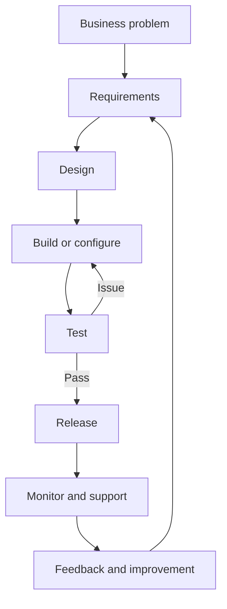
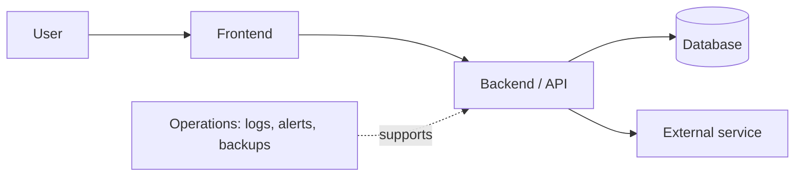

# 01 — Software & IT Fundamentals

[← Learning index](../README.md) · [Master topic map](00-master-topic-coverage-map.md)

> **Learning goal:** Is chapter ke baad aap simple language mein samjha sakoge ki software, IT aur IT services kya hain, companies technology se business problems kaise solve karti hain, aur ek basic software project kaise chalta hai.

## 1. Software kya hai?

**Software instructions ka set hai jo computer, phone ya kisi device ko batata hai ki kya kaam karna hai.** Software ko hum touch nahi kar sakte, lekin uska result screen, sound, report ya device ke action mein dekh sakte hain.

**Rozmarra ke examples**
- Calculator: numbers ka result nikalta hai.
- Maps app: location aur route dikhati hai.
- Online shopping app: products, cart aur orders manage karti hai.
- Office payroll software: salary calculate karne mein madad karta hai.

**Real IT example:** Ek online store ka software product list dikhata hai, cart mein items rakhta hai, order save karta hai aur delivery status dikhata hai. Ismein frontend, backend, database aur external services milkar kaam kar sakte hain.

## 2. IT aur IT Services kya hain?

**IT (Information Technology)** technology ka woh area hai jisme information ko create, collect, store, process, secure aur share kiya jata hai. Ismein computers, networks, software, cloud, databases aur technical support shamil hain.

**IT services** woh kaam hain jo kisi customer ya organization ke technology systems ko banane, set up karne, jodne, chalane, secure karne ya support karne ke liye diye jate hain.

Examples:
- Office ke laptops aur Wi-Fi ko manage karna.
- Company ke liye website ya internal app banana.
- Purane server se data cloud mein migrate karna.
- Security monitoring aur backup chalana.
- Employees ko login ya software issues mein help dena.

**Yaad rakho:** IT ek broad field hai; IT service us field ke andar deliver kiya gaya kaam hai. Har IT service software coding nahi hoti.

## 3. Software Development vs IT Services

| Term | Simple meaning | Example |
|---|---|---|
| Software development | Software plan, design, code, test aur improve karna | Booking app banana |
| IT support | Users ke technology issues solve karna | Employee ka email login fix karna |
| IT consulting | Problem samajhkar solution aur roadmap recommend karna | Cloud migration ka plan banana |
| Systems integration | Alag systems ko data share karne layak jodna | Website ko inventory system se connect karna |
| Managed services | Customer ke kuch IT operations ko regular basis par manage karna | Monitoring, backup aur patching manage karna |
| Cloud services | Internet ke through computing resources ya managed tools use karna | Cloud server ya hosted database use karna |

Ye categories overlap kar sakti hain. Ek hi company software bhi bana sakti hai aur uska support bhi de sakti hai.

## 4. IT industry kaise business problem solve karti hai?

Aksar process kuch is tarah hota hai:

1. **Problem samjho:** Customer ka pain point kya hai?
2. **Requirements likho:** System ko kya karna chahiye? Kya nahi karna chahiye?
3. **Design banao:** User flow, data, security aur system structure decide karo.
4. **Build ya configure karo:** Software likho ya existing tools set up karo.
5. **Test karo:** Check karo ki expected kaam ho raha hai aur important failures handle hote hain.
6. **Release karo:** Users ke liye system available karo.
7. **Operate karo:** Monitor, backup, support aur incidents handle karo.
8. **Improve karo:** Feedback aur data se next improvements plan karo.

**Important:** Real projects hamesha seedhi line mein nahi chalte. Testing ya user feedback ke baad requirements aur design par wapas jana normal hai.

## 5. Real-world case study: local shop ka online order system

Maan lo ek local shop phone calls aur notebook se orders leti hai. Orders miss ho jate hain aur stock ka hisaab late update hota hai.

**Business problem**
- Customer ko available products ka pata nahi chalta.
- Staff orders ko manually copy karta hai.
- Stock galat ho sakta hai.
- Owner ko daily sales report banana mushkil lagta hai.

**Possible technology solution**
1. Website par products aur prices dikhayein.
2. Order form customer aur item details collect kare.
3. Backend order ko validate karke save kare.
4. Database products, stock aur orders ka record rakhe.
5. Staff ke liye simple order dashboard ho.
6. Daily backup aur basic access control lagaya jaye.
7. Monitoring aur support ka process banaya jaye.

**Kaise pata chalega ki solution useful hai?**
- Missed orders kam hue?
- Order process karne ka time ghata?
- Stock records zyada accurate hue?
- Customer ko order status mil raha hai?
- System down hone par recovery ka plan hai?

Sirf website bana dena success nahi hai. Business problem ka measurable improvement bhi zaroori hai.

## 6. Product vs Service

**Product:** Ek reusable solution jo kai customers use kar sakte hain. Example: subscription-based accounting application.

**Service:** Kisi customer ke liye expertise, implementation ya ongoing work. Example: us accounting app ko company ke tax workflow ke hisaab se configure karna.

| Point | Product business | Service business |
|---|---|---|
| Main value | Reusable software/tool | Expertise aur delivery |
| Customers | Aksar kai customers same core product use karte hain | Kaam customer ke context ke hisaab se badal sakta hai |
| Revenue example | Subscription ya license | Project fee, hourly fee ya managed-service fee |
| Challenge | Product ko useful rakhna aur scale karna | Quality, delivery capacity aur customer expectations manage karna |

Koi company product aur services dono offer kar sakti hai.

## 7. Hardware, software aur firmware

- **Hardware:** Device ke physical parts—CPU, memory, keyboard, disk, router.
- **Software:** Programs aur applications—browser, operating system, spreadsheet.
- **Firmware:** Device ke andar stored low-level software jo hardware ke basic behaviour ko control karta hai.

**Router example:** Router ek physical hardware device hai. Uska firmware network traffic aur device functions manage karta hai. Usko configure karne ke liye web interface ya mobile app software ho sakta hai.

## 8. System software vs application software

- **System software** computer ke resources manage karta hai. Example: operating system, device drivers, system utilities.
- **Application software** user ka specific task karta hai. Example: browser, video editor, accounting app.

Kuch software dono categories ke beech complex role rakh sakte hain; ye beginner-level distinction hai, har product ki strict legal classification nahi.

## 9. Ek application ke common parts

Ek web application mein aam taur par ye parts ho sakte hain:

1. **Frontend:** Jo user screen par dekhta aur use karta hai.
2. **Backend:** Business rules aur server-side processing.
3. **Database:** Data ko organize karke store karta hai.
4. **API:** Systems ke beech request/response ka defined interface.
5. **Infrastructure:** Servers, network, cloud resources aur deployment environment.
6. **Security controls:** Login, permissions, encryption aur monitoring jaise controls.
7. **Operations:** Backups, alerts, incident response aur updates.

Har app mein ye parts alag services hona zaroori nahi. Chhoti application inmein se kai responsibilities ek hi application mein rakh sakti hai.

## 10. IT project mein kaun-kaun kaam karta hai?

- **Business owner / stakeholder:** Batata hai ki business ko kya result chahiye.
- **Business analyst / product manager:** Needs aur priorities clear karne mein help karta hai.
- **Designer / UX specialist:** User journey aur interface plan karta hai.
- **Developer:** Software build aur maintain karta hai.
- **QA / tester:** Expected behaviour aur defects check karta hai.
- **DevOps / platform engineer:** Build, release aur infrastructure workflows improve karta hai.
- **Security specialist:** Risks aur protective controls review karta hai.
- **IT support / operations:** System ko usable aur reliable rakhne mein help karta hai.

Chhoti team mein ek person multiple roles kar sakta hai. Har company mein job titles aur responsibilities same nahi hoti.

## 11. Basic terms — simple glossary

| Term | Aasan meaning |
|---|---|
| Data | Facts ya recorded information, jaise order number |
| Database | Data ko organized tareeke se store aur retrieve karne ka system |
| Server | Computer ya program jo doosre programs/users ko service deta hai |
| Client | Service request karne wala app ya device |
| Network | Devices ke beech communication ka connection |
| Cloud | Network ke through rented/on-demand computing resources aur services |
| API | Do software systems ke baat karne ka defined tareeka |
| Bug | Software ka defect ya unexpected behaviour |
| Deployment | Software version ko kisi environment mein release/install karna |
| Monitoring | System ki health aur behaviour par nazar rakhna |
| Backup | Data ki recoverable copy |
| Security | Systems aur data ko unauthorized access, misuse aur damage se bachana |

## 12. Beginner practice lab

**Task:** Kisi local shop, tuition centre ya small office ke liye ek simple technology solution plan karo.

1. Business ka naam aur uska main problem likho.
2. 3 user types identify karo—jaise customer, staff, owner.
3. Har user ke liye 2 requirements likho.
4. Decide karo ki frontend, backend aur database ki zaroorat hai ya nahi; apna reason likho.
5. 3 possible failure cases likho—jaise internet down, wrong order, lost password.
6. Data protection ke 3 rules likho—jaise limited access, strong login, backup.
7. Success measure ke 2 examples likho—jaise order processing time ya error rate.
8. Upar wale lifecycle diagram mein apne solution ke steps map karo.

**Expected output:** Ek page ka solution brief. Abhi coding zaroori nahi.

## 13. Knowledge check

Pehle khud answer do, phir neeche answers check karo.

1. Kya har IT service mein coding hoti hai?
2. Hardware aur firmware mein kya difference hai?
3. Product aur service mein main difference kya hai?
4. Software release ke baad kaam kyun khatam nahi hota?
5. Ek online shop mein database ka kya role hoga?
6. Testing mein issue mile to kya team ko hamesha project restart karna padega?

**Answer key**
1. Nahi. Support, setup, migration aur operations bhi IT services hain.
2. Hardware physical part hai; firmware usko control karne wala low-level program hai.
3. Product reusable solution hota hai; service expertise ya customer-specific delivery hoti hai.
4. Monitoring, support, security updates, backups aur improvements chalte rehte hain.
5. Products, orders aur related records ko store/retrieve karne mein help karega.
6. Nahi. Team issue fix karke dobara test kar sakti hai; process iterative hota hai.

## 14. Common beginner mistakes

- **Mistake:** Sochna ki IT ka matlab sirf coding hai.  
  **Better:** Networking, support, data, security, cloud aur operations bhi IT ka part hain.
- **Mistake:** Sochna ki software ban gaya to project complete ho gaya.  
  **Better:** Deployment, monitoring, maintenance aur user feedback bhi plan karo.
- **Mistake:** Har problem ke liye complicated architecture choose karna.  
  **Better:** Problem, budget, team skills aur risk ke hisaab se simplest suitable solution choose karo.
- **Mistake:** Security ko launch ke baad ka kaam samajhna.  
  **Better:** Requirements aur design se hi privacy aur security socho.
- **Mistake:** Sirf features count karke success measure karna.  
  **Better:** User outcome, reliability, cost aur business impact bhi measure karo.

## 15. Further learning — reliable starting points

- [What is software? — IBM](https://www.ibm.com/think/topics/software)
- [What is information technology? — IBM](https://www.ibm.com/think/topics/information-technology)
- [Software engineering — IEEE Computer Society](https://www.computer.org/education/bodies-of-knowledge/software-engineering)
- [NIST Cybersecurity Framework](https://www.nist.gov/cyberframework) — security and risk basics

External pages can change over time. Use them as starting points and verify current details when applying them to a real project.

## Chapter completion checklist

- [ ] Main concepts apni language mein explain kar sakta/sakti hoon.
- [ ] Product, service, development aur operations ka difference samjha sakta/sakti hoon.
- [ ] Shop case study ka simple solution diagram bana sakta/sakti hoon.
- [ ] Practice lab ka one-page brief complete kiya hai.
- [ ] Knowledge-check questions bina notes dekhe answer kar sakta/sakti hoon.

**Coverage status:** Beginner explanation + examples + diagrams + practice lab included. This chapter is not a claim of expert-level coverage; deeper role-specific topics are covered in later chapters.
