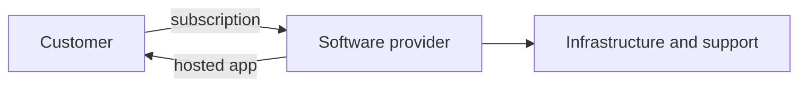

# 02 — Software Business Models

[← Learning index](../README.md)

## Software company paise kaise kamati hai?
- Subscription: monthly/yearly fee.
- One-time license: ek baar license payment.
- Usage-based: usage ke hisaab se bill.
- Project fee: agreed work deliver karne ka payment.
- Managed service: ongoing support/operations contract.
- Advertising ya transaction fee: ads ya transactions se revenue.

Example: cloud platform CPU/storage usage ke hisaab se bill kar sakta hai; agency custom website ke liye project fee le sakti hai.

## SaaS, PaaS, IaaS
- SaaS: ready application internet se use hoti hai.
- PaaS: app build/run karne ka managed platform.
- IaaS: virtual servers, storage aur networking.
Details ke liye [Cloud & Infrastructure](06-cloud-infrastructure.md) dekho.

## B2B, B2C, B2G
- B2B: business to business.
- B2C: business to consumer.
- B2G: business to government.
Example: company ke liye HR software B2B hai; consumer shopping app B2C hai.

## Product vs service company
Product company reusable product evolve karti hai. Service company customer-specific projects, integrations, consulting ya operations deliver karti hai. Ek company dono kar sakti hai.

## Cost aur ROI
Total cost mein license, implementation, training, migration, support, cloud usage aur exit cost shamil ho sakti hai. ROI investment ke comparison mein measurable benefit ko evaluate karta hai.

## Practice
1. Ek B2B aur ek B2C example do.
2. Subscription aur usage-based billing ka difference batao.
3. Software choose karte waqt data export aur vendor lock-in kyun check karna chahiye?

## Visual example (diagram)

**SaaS example** — is simplified flow ko real system ke example ki tarah dekhein.

## Deep learning: business models ko real company se kaise jodein?

### Revenue aur profit same nahi hote
- **Revenue:** customers se aaya total paisa.
- **Direct delivery cost:** service/product deliver karne ki seedhi cost, jaise cloud usage ya project team time.
- **Gross profit:** revenue minus direct cost.
- **Operating expenses:** sales, marketing, admin, rent aur other running costs.
- **Cash flow:** paisa business mein kab aata aur kab jata hai. Profitable company bhi cash-flow problem face kar sakti hai.

**Example:** Agency ko website project ke ₹2,00,000 milte hain. Delivery par ₹1,10,000 aur allocated operating costs par ₹50,000 lagte hain. Simple illustration ke liye ₹40,000 bachta hai; actual accounting mein taxes, timing aur cost allocation bhi matter karte hain.

### Common revenue models — trade-offs
| Model | Customer ka payment | Benefit | Risk/challenge |
|---|---|---|---|
| Subscription | Regular monthly/yearly fee | Predictable recurring revenue | Customer ko value milti rehni chahiye |
| Perpetual license | Usually one-time license fee | Large upfront sale possible | Updates/support ka separate model chahiye |
| Usage-based | Actual usage ke hisaab se | Small start, usage ke saath growth | Bill unpredictable ho sakta hai |
| Project fee | Defined scope ke liye agreed fee | Deliverable aur budget clear | Scope change aur estimation risk |
| Time and materials | Hours/days aur expenses ke hisaab se | Changing requirements mein flexible | Customer ko cost visibility chahiye |
| Managed service | Ongoing service contract | Regular revenue, ongoing relationship | Service quality aur SLA maintain karna |
| Freemium | Basic free, advanced paid | Users ko try karna easy | Free users ki serving cost control karni hoti hai |
| Transaction fee | Successful transaction ka share | Business volume se earning linked | Transactions aur regulation par dependency |

### SaaS, PaaS aur IaaS ko samjho
- **SaaS:** ready application use karo; provider most underlying technology manage karta hai.
- **PaaS:** app build/deploy karne ke liye managed platform.
- **IaaS:** compute, storage aur networking jaise infrastructure resources rent karo; customer ko zyada configuration/manage karna pad sakta hai.

Responsibility exact provider aur service ke hisaab se change hoti hai. Cloud use karne ka matlab security ki poori responsibility provider par chhod dena nahi hai.

### Mini case study: appointment booking app
1. Customer appointments book karta hai.
2. Free tier limited bookings de sakta hai; paid plan reminders aur reporting add kar sakta hai.
3. Business ko estimate karna hai: har customer ko serve karne ki cost, support load, payment fees aur churn.
4. Trial se pata chalega ki customers kis feature ke liye pay karne ko ready hain.
5. Pricing page par limits, billing period, cancellation aur overage rules clearly batane chahiye.

### Business metrics
- **MRR/ARR:** monthly/annual recurring revenue ka snapshot; definitions consistently use karo.
- **Churn:** kitne customers ya recurring revenue ne period mein leave kiya.
- **CAC:** ek customer acquire karne ki average cost.
- **LTV:** customer relationship se expected value; estimates assumptions par depend karte hain.
- **Gross margin:** revenue ka woh hissa jo direct delivery costs ke baad bachta hai.

Ek metric akela business health prove nahi karta. Period, segment aur calculation method clear rakho.

### Practice lab
Ek fictional IT company choose karo: website agency, SaaS task manager, ya managed IT support.
1. Target customer aur uski problem likho.
2. Do possible revenue models compare karo.
3. Monthly fixed aur variable costs ki example list banao.
4. Customer ko value milne ka ek measurable indicator choose karo.
5. Pricing ke 3 risks aur customer ko clearly batane wali 3 conditions likho.

### Knowledge check
1. Revenue aur profit mein kya difference hai?
2. Subscription model mein customer ko ongoing value kyun chahiye?
3. Usage-based billing ka customer ke liye ek risk kya hai?
4. SaaS use karne par customer ki security responsibility khatam ho jati hai? **Nahi**—responsibilities shared hoti hain.
5. CAC kam ho raha ho, phir bhi business fail kyun ho sakta hai? Revenue quality, churn, delivery costs aur cash flow bhi matter karte hain.

### Further learning
- [AWS — Cloud Computing](https://aws.amazon.com/what-is-cloud-computing/)
- [Microsoft — What is SaaS?](https://azure.microsoft.com/en-us/resources/cloud-computing-dictionary/what-is-saas/)

## Quick answer guide
1. Revenue is total income from sales; profit is what remains after the relevant costs.
2. Subscription customers need ongoing value because they can stop renewing.
3. Usage-based bills may be hard to predict when demand spikes.
4. No. Cloud security responsibilities are shared and vary by service.
5. Low CAC alone cannot guarantee success: churn, margin, cash flow and product value also matter.

## Review status
- Content milestone: practical beginner expansion.
- Verification status: not yet independently deep-reviewed.
- Last content expansion: 2026-10-30.
- Next review: verify examples and links, add worked pricing calculation, and validate the chapter against the master coverage map.

## Lab review checklist
A strong submission should identify a specific customer and problem; compare at least two revenue models using explicit assumptions; separate fixed and variable costs; explain what value the customer receives over time; and list pricing, cancellation, tax/legal and delivery-cost assumptions that need validation. Exact prices cannot be judged without market and cost evidence.
