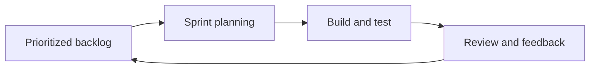

# 03 — SDLC & Development Methodologies

[← Learning index](../README.md)

## SDLC kya hai?
Software Development Life Cycle software banane aur maintain karne ka process hai.

1. Requirements: user ki problem samajhna.
2. Planning: scope, timeline, cost aur risks.
3. Design: UI, architecture, data aur workflows.
4. Development: code/configuration.
5. Testing: expected behavior verify karna.
6. Deployment: users ke liye release.
7. Maintenance: monitor, fix aur improve karna.

Example: leave-management app mein leave rules confirm, screens design, balance logic implement, tests run aur deployment hota hai.

## Waterfall vs Agile
Waterfall phases ko mostly sequence mein chalata hai. Agile short cycles, feedback aur changing requirements par focus karta hai. Best choice project risk, regulation, team aur customer needs par depend karti hai.

## Scrum
Scrum mein team Sprint ke andar selected work karti hai. Common concepts: Product Backlog, Sprint Planning, Daily Scrum, Sprint Review aur Retrospective. Example: 2-week Sprint mein login aur password-reset flow deliver karna.

## Kanban
Kanban workflow ko board par visualize karta hai aur Work In Progress ko limit karta hai. Example: To do → In progress → Review → Done. Review column bhar raha ho to team bottleneck solve karti hai.

## Requirements & acceptance criteria
Requirement batati hai user ko kya chahiye. Acceptance criteria batate hain feature kab correct maana jayega. Example: user verified email se password reset kare; expired link reject ho aur success ke baad sign-in possible ho.

## CI/CD and safe release
Automated build, tests aur deployment errors jaldi pakadte hain. Safe release practices: code review, automated tests, feature flags, canary rollout, monitoring aur rollback plan. Example: pehle 5% users ko feature do; error rate badhe to flag disable karo.

## Practice
1. SDLC ke stages apne words mein explain karo.
2. Scrum aur Kanban ka key difference likho.
3. Production release se pehle 5 safety checks likho.

## Visual example (diagram)

**Agile delivery loop** — is simplified flow ko real system ke example ki tarah dekhein.

