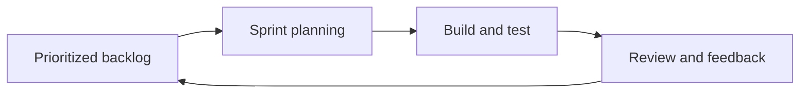
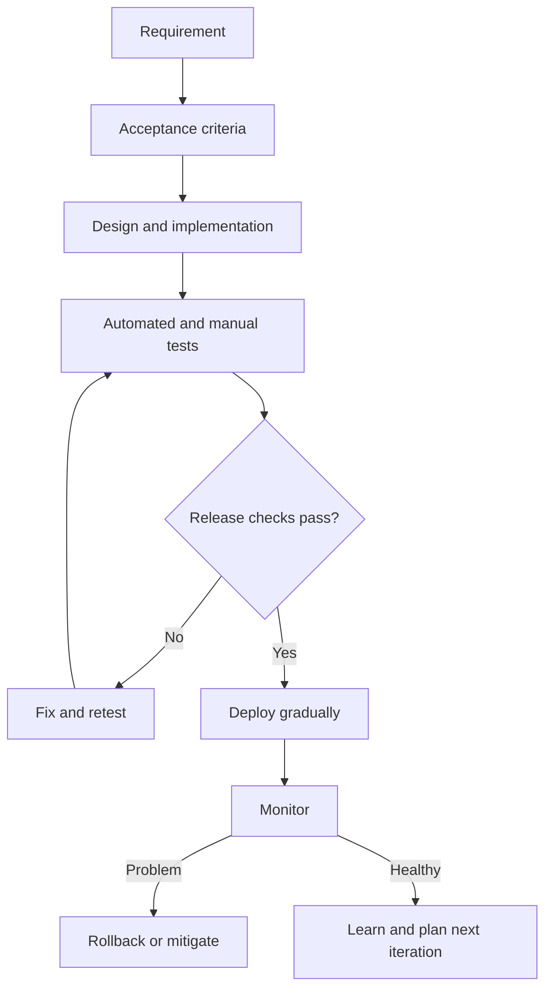

# 03 — SDLC & Development Methodologies

**Project:** Software & IT Services — Deep Research & Study Notes  
**Owner / Content Creator:** Sandeep Barupal  
**Copyright:** © 2026 Sandeep Barupal. All rights reserved, except as stated below.

[← Learning index](../README.md)

## SDLC kya hai?
Software Development Life Cycle software banane aur maintain karne ka process hai.

1. Requirements: user ki problem samajhna.
2. Planning: scope, timeline, cost aur risks.
3. Design: UI, architecture, data aur workflows.
4. Development: code/configuration.
5. Testing: expected behavior verify karna.
6. Deployment: users ke liye release.
7. Maintenance: monitor, fix aur improve karna.

Example: leave-management app mein leave rules confirm, screens design, balance logic implement, tests run aur deployment hota hai.

## Waterfall vs Agile
Waterfall phases ko mostly sequence mein chalata hai. Agile short cycles, feedback aur changing requirements par focus karta hai. Best choice project risk, regulation, team aur customer needs par depend karti hai.

## Scrum
Scrum mein team Sprint ke andar selected work karti hai. Common concepts: Product Backlog, Sprint Planning, Daily Scrum, Sprint Review aur Retrospective. Example: 2-week Sprint mein login aur password-reset flow deliver karna.

## Kanban
Kanban workflow ko board par visualize karta hai aur Work In Progress ko limit karta hai. Example: To do → In progress → Review → Done. Review column bhar raha ho to team bottleneck solve karti hai.

## Requirements & acceptance criteria
Requirement batati hai user ko kya chahiye. Acceptance criteria batate hain feature kab correct maana jayega. Example: user verified email se password reset kare; expired link reject ho aur success ke baad sign-in possible ho.

## CI/CD and safe release
Automated build, tests aur deployment errors jaldi pakadte hain. Safe release practices: code review, automated tests, feature flags, canary rollout, monitoring aur rollback plan. Example: pehle 5% users ko feature do; error rate badhe to flag disable karo.

## Practice
1. SDLC ke stages apne words mein explain karo.
2. Scrum aur Kanban ka key difference likho.
3. Production release se pehle 5 safety checks likho.

## Visual example (diagram)

**Agile delivery loop** — is simplified flow ko real system ke example ki tarah dekhein.

## Deep learning: SDLC ko practical project par apply karo

### Requirements ke 3 useful types
1. **Functional:** system kya karega? Example: employee leave request submit kar sake.
2. **Non-functional:** quality ya constraint kya hai? Example: common screen 2 seconds ke andar load ho under a defined test condition.
3. **Business rule:** decision ka rule kya hai? Example: manager approval se pehle leave approved status mein nahi jayegi.

**Weak requirement:** “App fast aur modern honi chahiye.”  
**Better requirement:** “Given 1,000 sample records and the agreed test environment, the employee list should load within 2 seconds at the 95th percentile.” Actual target stakeholders aur measurement method ke saath agree karna chahiye.

### User story aur acceptance criteria
**User story:** “As an employee, I want to see my leave balance so that I can plan time off.”

**Acceptance criteria:**
- Logged-in employee apna balance dekh sake.
- Employee doosre employee ka private balance na dekh sake.
- No balance record ho to clear message aaye.
- API/server error ho to user ko retry/help message mile; app silently incorrect balance na dikhaye.

Acceptance criteria testable hone chahiye, sirf “works properly” nahi.

### Methodologies ka practical comparison
| Approach | Kab useful ho sakta hai | Trade-off |
|---|---|---|
| Waterfall/sequential | Requirements stable aur approvals formal hon | Late change expensive ho sakta hai |
| V-Model | Verification/validation mapping important ho | Change management carefully plan karna hota hai |
| Agile iterations | Feedback aur changing priorities common hon | Stakeholder availability aur prioritization chahiye |
| Scrum | Team fixed cadence aur defined roles/events use karna chahe | Ceremonies ko unnecessary overhead na banne dein |
| Kanban | Continuous incoming work aur flow management ho | Work-in-progress limits aur priority discipline chahiye |
| Hybrid | Compliance, procurement ya legacy constraints ke saath iterative delivery | Interfaces aur decision ownership clear honi chahiye |

Koi approach har project ke liye best nahi hota. Team, risk, customer feedback, regulation aur delivery constraints ke basis par choose karo.

### Planning mein kya track karein?
- Scope aur out-of-scope items
- Milestones, dependencies aur owners
- Risks, assumptions aur decisions
- Estimates aur confidence level
- Change requests aur unka impact
- Defects, release readiness aur support handover

Estimate commitment nahi hota. New information aane par estimate revise karna normal hai.

### Mini case: leave-management feature
1. Stakeholders se leave rules confirm karo.
2. User story aur acceptance criteria likho.
3. Happy path ke saath rejected request, overlapping dates, no balance aur permission failures test karo.
4. Small change ko test environment mein release karo.
5. Logs/metrics aur rollback plan check karo.
6. Users se feedback lo aur next iteration plan karo.

### Practice lab
Ek login ya leave-request feature ke liye 5 functional requirements, 3 non-functional requirements, 5 acceptance criteria, 5 failure cases aur release checklist likho.

### Knowledge check
1. Requirement aur acceptance criterion mein difference?
2. Agile ka matlab planning bilkul nahi hoti? **Nahi**—planning iterative ho sakti hai.
3. Test pass hone ke baad bhi release risk kyun hota hai? Production config, data, traffic aur dependencies different ho sakte hain.
4. Rollback aur hotfix ka purpose kya hai? Incident impact ko safely reduce karna; choice situation par depend karti hai.

### Further learning
- [Agile Manifesto](https://agilemanifesto.org/)
- [Scrum Guide](https://scrumguides.org/scrum-guide.html)
- [NIST Secure Software Development Framework (SSDF)](https://csrc.nist.gov/Projects/ssdf)

## Quick answer guide
1. A requirement describes a need/constraint; acceptance criteria define observable conditions for accepting the work.
2. Agile does not remove planning; it allows plans to adapt as learning improves.
3. Production can differ from test environments in configuration, data, traffic and dependencies.
4. Rollback returns to a safer previous state when feasible; a hotfix changes the faulty behaviour. Some data migrations make rollback non-trivial.

## Review status
- Content milestone: practical beginner expansion.
- Verification status: not yet independently deep-reviewed.
- Last content expansion: 2026-10-30.
- Next review: add a worked estimation example and verify all SDLC topics against the master map.

## Worked example: feature delivery from request to release

**Request:** “Employees should request annual leave online.”

1. **Clarify rules:** allowed dates, balance calculation, public holidays, approval chain, cancellation and time-zone rules.
2. **Define scope:** submit request, view status, approve/reject. Payroll integration is out of scope for the first release unless explicitly required.
3. **Write acceptance criteria:** employee sees only own requests; manager sees only assigned team requests; rejected requests show reason; overlapping/invalid dates are rejected.
4. **Design:** data model, permission checks, API contract, audit trail and error states.
5. **Implement in small increments:** first read-only balance, then request submission, then manager approval.
6. **Test:** valid request, zero balance, invalid dates, unauthorized access, duplicate submission and database timeout.
7. **Release:** deploy to test users, monitor errors, then expand access.
8. **Review:** compare actual usage/support tickets with the intended outcome.

**Done means evidence:** acceptance criteria pass, permissions are tested, known limitations are documented, monitoring exists and support knows how to troubleshoot.

## Lab review checklist
A strong submission includes measurable requirements, testable acceptance criteria, a named owner for key risks, happy-path and failure tests, and a release/rollback plan. Requirements should avoid vague terms like “fast” unless a measurement condition is defined. If scope changes, the submission should explain impact on timeline, cost, risk and quality.
