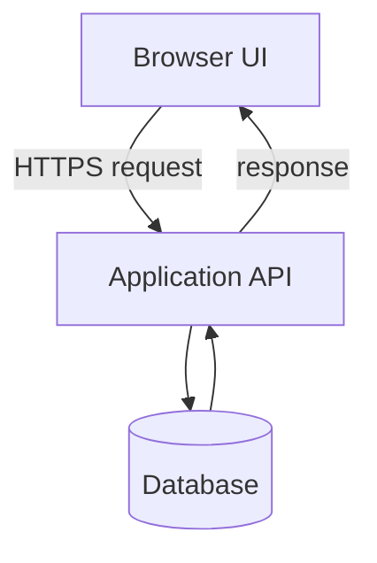

# 04 — Programming & Web Development

[← Learning index](../README.md)

## Frontend, backend, database
Frontend user interface hai. Backend server-side rules, permissions aur processing karta hai. Database persistent data store karta hai. Ye parts APIs se communicate kar sakte hain.

Example: login screen frontend hai, credentials verify karne wala server backend hai, user record database mein ho sakta hai.

## HTML, CSS, JavaScript
- HTML: page structure/content.
- CSS: layout, colors, spacing aur responsive styling.
- JavaScript: interactions aur dynamic behavior.
Example: HTML button banata hai, CSS style karti hai, JavaScript click par modal khol sakti hai.

## Programming languages
JavaScript/TypeScript web UI aur server work mein; Python automation/data work mein; Java/C# enterprise apps mein; SQL database queries mein common hain. Choice requirements, ecosystem aur team skills par depend karti hai.

## Libraries vs frameworks
Library reusable functionality deti hai. Framework app structure aur conventions define kar sakta hai. React UI components banane ke liye use hota hai.

## Responsive design
UI mobile, tablet aur desktop par adapt hona chahiye. Flexible layouts, media queries, readable text aur touch-friendly controls use karo.

## Accessibility
Semantic HTML, form labels, keyboard navigation, visible focus, readable contrast aur meaningful image descriptions accessibility improve karte hain.

## Browser concurrency
Browser network requests, rendering, input aur JavaScript tasks coordinate karta hai. Long-running main-thread work UI freeze kar sakta hai. Heavy tasks optimize karo; suitable cases mein Web Workers use ho sakte hain.

## Practice
1. Signup form ke frontend, backend aur database parts identify karo.
2. HTML, CSS aur JavaScript ki responsibilities likho.
3. Mobile UI accessible banane ke 4 steps likho.

## Visual example (diagram)

**Web request flow** — is simplified flow ko real system ke example ki tarah dekhein.




## Deep learning: browser se server tak request ka safar

Jab user website par button click karta hai, aam flow kuch aisa ho sakta hai:
1. HTML page ka structure provide karta hai.
2. CSS layout, spacing, typography aur responsive presentation set karti hai.
3. JavaScript click event handle karke input validate kar sakti hai.
4. Browser API request bhejta hai.
5. Server request validate karta hai, permissions check karta hai aur business rules run karta hai.
6. Zaroorat ho to server database ya external service se baat karta hai.
7. Response browser ko milta hai; UI success ya error state dikhati hai.

Client-side validation user experience ke liye useful hai, lekin security ke liye server par bhi validation aur authorization zaroori hain. Browser mein chhupaya hua button permission control ka substitute nahi.

### Programming building blocks
- **Variable:** value ko naam se refer karne ka tareeka.
- **Condition:** situation ke hisaab se decision.
- **Loop:** repeated work.
- **Function:** reusable operation.
- **Data structure:** related data organize karne ka format.
- **Error handling:** failure ko detect karke safe response dena.
- **Module:** code ko logical units mein divide karna.

### Example: safe UI behaviour
Login form mein empty email ko frontend par highlight kiya ja sakta hai. Server ko phir bhi input format, rate limits, authentication, session handling aur authorization verify karna hota hai. Password ko logs ya URL mein kabhi include nahi karna chahiye.

### Responsive web design
- Mobile, tablet aur desktop widths par layout test karo.
- Semantic HTML aur keyboard navigation use karo.
- Images ko suitable size/format mein deliver karo.
- Loading, empty, error aur success states design karo.
- Accessibility checks ko end mein nahi, development ke dauran karo.

### Common web risks
- Untrusted input ko safe handling ke bina render karna.
- Secrets ya private keys ko frontend bundle mein rakhna.
- API errors ko ignore karna aur UI ko stale data dikhane dena.
- Buttons ko disabled karke server permissions implement samajh lena.
- Sirf ek screen size ya ek browser mein test karna.

### Practice lab
Ek product-list page ka static prototype banao:
1. Semantic HTML se header, main content aur product cards banao.
2. CSS se responsive grid banao.
3. JavaScript se search/filter interaction add karo.
4. Empty result aur invalid input state handle karo.
5. Keyboard-only navigation aur mobile width test karo.
6. Ek short note likho: real API connect karte waqt server-side validation aur loading/error states kaise add karoge?

### Knowledge check
1. HTML, CSS aur JavaScript ke roles kya hain?
2. Frontend validation akeli security ke liye sufficient kyun nahi?
3. Empty state aur error state mein difference?
4. Responsive design sirf screen ko chhota karna hai? **Nahi**—content, input methods, readability aur layout behaviour bhi matter karte hain.

### Further learning
- [MDN — Learn Web Development](https://developer.mozilla.org/en-US/docs/Learn_web_development)
- [MDN — Accessibility](https://developer.mozilla.org/en-US/docs/Web/Accessibility)
- [OWASP Top 10](https://owasp.org/projects/top-ten/)


## Quick answer guide
1. HTML provides structure, CSS presentation, and JavaScript behaviour/interactivity.
2. Client code can be modified or bypassed, so the server must enforce validation and permissions.
3. Empty means no matching/available content; error means the operation failed or could not be completed.
4. Responsive design also accounts for readability, input method, content order and accessibility.

## Review status
- Content milestone: practical beginner expansion.
- Verification status: not yet independently deep-reviewed.
- Last content expansion: 2026-10-30.
- Next review: add a runnable mini-project with expected files/output and verify browser examples.


## Runnable mini-lab: searchable product list

Is example ko ek folder mein `index.html` ke naam se save karke browser mein open karo. Ye frontend-only learning demo hai; ismein real API, checkout ya user data nahi hai.

```html
<!doctype html>
<html lang="en">
<head>
  <meta charset="utf-8">
  <meta name="viewport" content="width=device-width, initial-scale=1">
  <title>Product Search Lab</title>
  <style>
    body { font-family: system-ui, sans-serif; max-width: 48rem; margin: 2rem auto; padding: 0 1rem; }
    input { width: 100%; padding: .7rem; box-sizing: border-box; }
    li { padding: .5rem 0; }
    #status { min-height: 1.5rem; }
  </style>
</head>
<body>
  <h1>Product Search Lab</h1>
  <label for="search">Search products</label>
  <input id="search" type="search" autocomplete="off" placeholder="Try keyboard">
  <p id="status" aria-live="polite"></p>
  <ul id="results"></ul>

  <script>
    const products = [
      { name: "Wireless Keyboard", category: "Accessories" },
      { name: "USB-C Hub", category: "Accessories" },
      { name: "Laptop Stand", category: "Office" }
    ];

    const search = document.querySelector("#search");
    const results = document.querySelector("#results");
    const status = document.querySelector("#status");

    function renderProducts(query) {
      const normalizedQuery = query.trim().toLowerCase();
      const matches = products.filter(product =>
        product.name.toLowerCase().includes(normalizedQuery) ||
        product.category.toLowerCase().includes(normalizedQuery)
      );

      results.replaceChildren();
      for (const product of matches) {
        const item = document.createElement("li");
        item.textContent = `${product.name} — ${product.category}`;
        results.append(item);
      }

      status.textContent = matches.length === 0
        ? "No matching products."
        : `${matches.length} product(s) found.`;
    }

    search.addEventListener("input", event => renderProducts(event.target.value));
    renderProducts("");
  </script>
</body>
</html>
```

### Expected result
- Initial load: 3 products shown.
- Search `keyboard`: Wireless Keyboard shown.
- Search `office`: Laptop Stand shown.
- Search `xyz`: “No matching products.” shown.
- Keyboard users can reach the labelled search field; the result count uses an `aria-live` region.

### Extend the lab
1. Add a clear-search button.
2. Add a category filter.
3. Move data to a separate JSON file and handle fetch failure.
4. Add loading/error states before using a real API.
5. Test at narrow screen width and with keyboard-only navigation.

**Safety note:** `textContent` is used to insert text safely. If rendering untrusted content, do not blindly use `innerHTML`.
