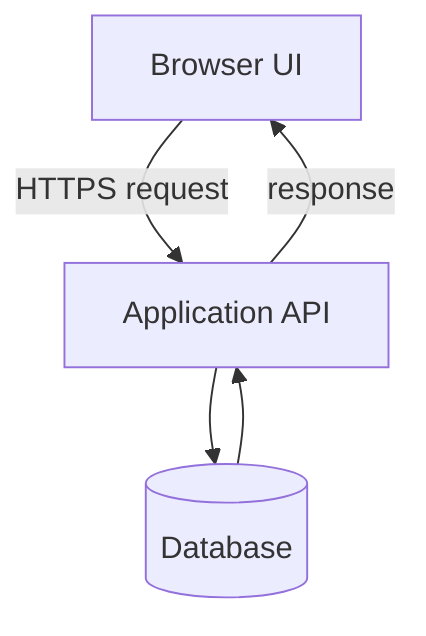

# 04 — Programming & Web Development

[← Learning index](../README.md)

## Frontend, backend, database
Frontend user interface hai. Backend server-side rules, permissions aur processing karta hai. Database persistent data store karta hai. Ye parts APIs se communicate kar sakte hain.

Example: login screen frontend hai, credentials verify karne wala server backend hai, user record database mein ho sakta hai.

## HTML, CSS, JavaScript
- HTML: page structure/content.
- CSS: layout, colors, spacing aur responsive styling.
- JavaScript: interactions aur dynamic behavior.
Example: HTML button banata hai, CSS style karti hai, JavaScript click par modal khol sakti hai.

## Programming languages
JavaScript/TypeScript web UI aur server work mein; Python automation/data work mein; Java/C# enterprise apps mein; SQL database queries mein common hain. Choice requirements, ecosystem aur team skills par depend karti hai.

## Libraries vs frameworks
Library reusable functionality deti hai. Framework app structure aur conventions define kar sakta hai. React UI components banane ke liye use hota hai.

## Responsive design
UI mobile, tablet aur desktop par adapt hona chahiye. Flexible layouts, media queries, readable text aur touch-friendly controls use karo.

## Accessibility
Semantic HTML, form labels, keyboard navigation, visible focus, readable contrast aur meaningful image descriptions accessibility improve karte hain.

## Browser concurrency
Browser network requests, rendering, input aur JavaScript tasks coordinate karta hai. Long-running main-thread work UI freeze kar sakta hai. Heavy tasks optimize karo; suitable cases mein Web Workers use ho sakte hain.

## Practice
1. Signup form ke frontend, backend aur database parts identify karo.
2. HTML, CSS aur JavaScript ki responsibilities likho.
3. Mobile UI accessible banane ke 4 steps likho.

## Visual example (diagram)

**Web request flow** — is simplified flow ko real system ke example ki tarah dekhein.

