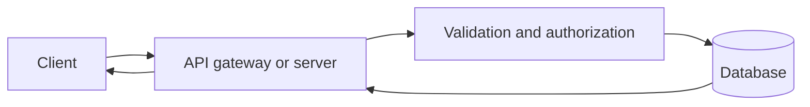

# 05 — Databases, APIs & Integration

[← Learning index](../README.md)

## Database basics
Database data ko store, retrieve, update aur organize karta hai. Example: Members table mein member ID, name aur department ID ho sakte hain.

## SQL vs NoSQL
SQL relational tables aur structured queries ke liye common hai. NoSQL document, key-value, graph aur doosre data models support karta hai. Choice data structure, queries, scale aur consistency needs par depend karti hai.

## API kya hai?
API systems ke beech communication ka contract hai. Ye define karta hai kaun se inputs, outputs, permissions aur errors possible hain. Example: GET /products products list deta hai; POST /orders order create kar sakta hai.

## HTTP methods and status codes
- GET: read data.
- POST: create/action.
- PUT/PATCH: replace/update.
- DELETE: delete.
Common status codes: 200 success, 201 created, 400 invalid request, 401 unauthenticated, 403 forbidden, 404 not found, 500 server error. Exact behavior API documentation se confirm karo.

## Authentication vs authorization
Authentication identity verify karti hai. Authorization permissions decide karti hai. Login successful hona authentication hai; sirf HR manager ko salary records access dena authorization hai.

## Integrations and webhooks
Integration systems ko data/workflow share karne deti hai. Webhook event hone par doosre endpoint ko notification bhej sakta hai. Retries, duplicate events, signatures aur failures handle karo.

## Practice
1. API ko real-world example se samjhao.
2. 401 aur 403 mein difference batao.
3. Salary data ke liye authorization kyun critical hai?

## Visual example (diagram)

**API and database flow** — is simplified flow ko real system ke example ki tarah dekhein.

## Deep learning: data ko reliable tareeke se manage karna

### Data modelling basics
- **Entity:** jis cheez ka record rakhna hai, jaise Customer ya Order.
- **Attribute:** entity ki property, jaise order date.
- **Primary key:** record ko uniquely identify karti hai.
- **Foreign key:** related record ka reference deti hai.
- **Constraint:** invalid data ko rokne ka rule.
- **Index:** common queries ko faster banane mein help kar sakta hai, lekin extra storage aur write cost bhi hoti hai.

**Example:** Customer ke multiple orders ho sakte hain. Orders table mein customer ID rakhne se har order ko uske customer se link kiya ja sakta hai. Duplicate ya missing references ko database constraints se prevent kiya ja sakta hai.

### SQL vs NoSQL — decision kaise lein?
SQL relational data, joins aur transaction rules ke liye common choice hai. NoSQL ek single database type nahi—document, key-value, wide-column aur graph models jaise options ka group hai. Choice access patterns, consistency, relationships, operational skills aur scaling needs par depend karti hai. “NoSQL hamesha faster hai” ya “SQL hamesha better hai” jaise blanket claims avoid karo.

### Transactions aur consistency
Transaction related changes ko ek logical unit ki tarah handle karti hai. Example: payment ke baad order status update karna. Agar multi-step operation fail ho, system ko defined recovery behaviour chahiye. Database transaction external payment provider ke saath poore distributed workflow ko automatically atomic nahi banati; wahan idempotency, retries aur reconciliation ki zaroorat ho sakti hai.

### API contract ke essentials
Ek API ko document karna chahiye:
- Endpoint aur HTTP method
- Request fields aur validation
- Successful response shape
- Error codes aur error format
- Authentication/authorization requirements
- Pagination, filtering aur sorting rules
- Rate limits, timeouts aur retry guidance
- Versioning aur compatibility policy

**Example:** `GET /products?page=1` products list return kar sakta hai. Client ko empty list, invalid query, unauthenticated request, rate limiting aur server failure ke cases bhi handle karne chahiye. Exact status codes API design par depend karte hain.

### Reliability patterns
- **Timeout:** request ko indefinitely wait karne se rokta hai.
- **Retry:** temporary failure par dobara try karta hai; exponential backoff aur jitter overload ko reduce kar sakte hain.
- **Idempotency:** same request repeat hone par duplicate harmful action se bachane ka contract.
- **Pagination:** huge result ko manageable pages mein return karna.
- **Rate limiting:** excessive requests ko limit karna.
- **Schema migration:** data structure ko controlled tareeke se update karna; backup aur rollback/forward strategy plan karo.

### Security and privacy
Least-privilege database accounts use karo. Sensitive data ko unnecessarily collect na karo. Secrets source code mein commit na karo. SQL queries mein parameterized statements/prepared queries use karo; user input ko query string mein concatenate karna injection risk create kar sakta hai. Logs mein passwords, access tokens aur unnecessary personal data avoid karo.

### Practice lab
A simple inventory app ka design banao:
1. Products aur Orders ke fields define karo.
2. Primary key aur relationships identify karo.
3. Product list API ka request/response example likho.
4. Invalid ID, missing permission, empty results aur server timeout ke behaviours define karo.
5. Ek duplicate order request ka risk samjhao aur idempotency ka proposed solution likho.
6. Data migration se pehle backup aur validation steps likho.

### Knowledge check
1. Primary key aur foreign key ka role?
2. Index ka trade-off kya hai?
3. Retry har failure par unlimited kyun nahi karna chahiye?
4. API contract mein errors kyun document karne chahiye?
5. Frontend se hidden database credentials secure ho jate hain? **Nahi**—secrets ko trusted server-side environment mein rakho.

### Further learning
- [PostgreSQL Documentation](https://www.postgresql.org/docs/)
- [MDN — HTTP](https://developer.mozilla.org/en-US/docs/Web/HTTP)
- [OWASP SQL Injection Prevention Cheat Sheet](https://cheatsheetseries.owasp.org/cheatsheets/SQL_Injection_Prevention_Cheat_Sheet.html)
