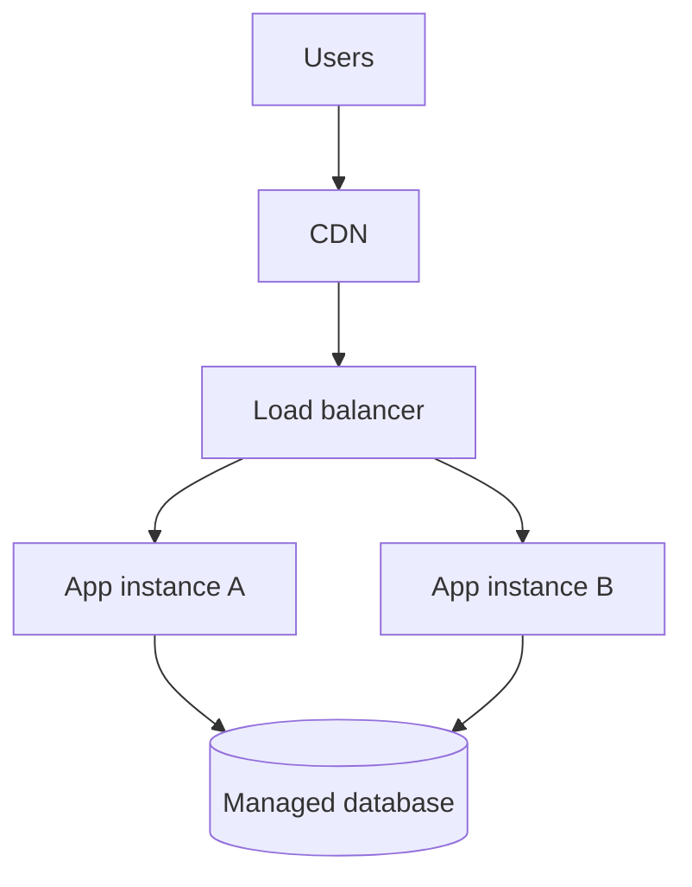

# 06 — Cloud & Infrastructure

[← Learning index](../README.md)

## Cloud computing
Cloud providers compute, storage, databases aur networking on-demand provide karte hain. Benefits: fast provisioning aur flexible scaling. Risks: unexpected cost, outages, security misconfiguration aur vendor dependence.

## IaaS, PaaS, SaaS
- IaaS: virtual servers, disks, networks.
- PaaS: managed platform/runtime.
- SaaS: ready-to-use application.
Service ke hisaab se provider aur customer ki responsibilities change hoti hain.

## Regions and availability zones
Region geographic area hota hai; availability zones isolated infrastructure locations ho sakti hain. Multiple zones resilience improve kar sakti hain, lekin app aur data design bhi failure-ready hona chahiye.

## CDN and caching
CDN users ke paas edge locations se content deliver karta hai. Cache frequently used data temporarily store karta hai, latency aur backend load kam karne ke liye. Example: website images CDN se load hon; product list cache ho. Stale data/invalidation plan karo.

## DNS, domains, TLS/HTTPS
DNS domain ko network records se resolve karta hai. TLS connection encrypt karta hai aur certificate ke through server identity verify karne mein help karta hai. HTTPS websites ke liye important hai.

## Cloud cost management
Budgets, alerts, resource tags, rightsizing aur unused resource cleanup use karo. Sirf compute price nahi, data transfer, support aur reliability costs bhi compare karo.

## Practice
1. IaaS, PaaS, SaaS ke examples do.
2. CDN aur cache ka difference samjhao.
3. Cloud bill achanak badhe to kya investigate karoge?

## Visual example (diagram)

**Cloud application layout** — is simplified flow ko real system ke example ki tarah dekhein.

