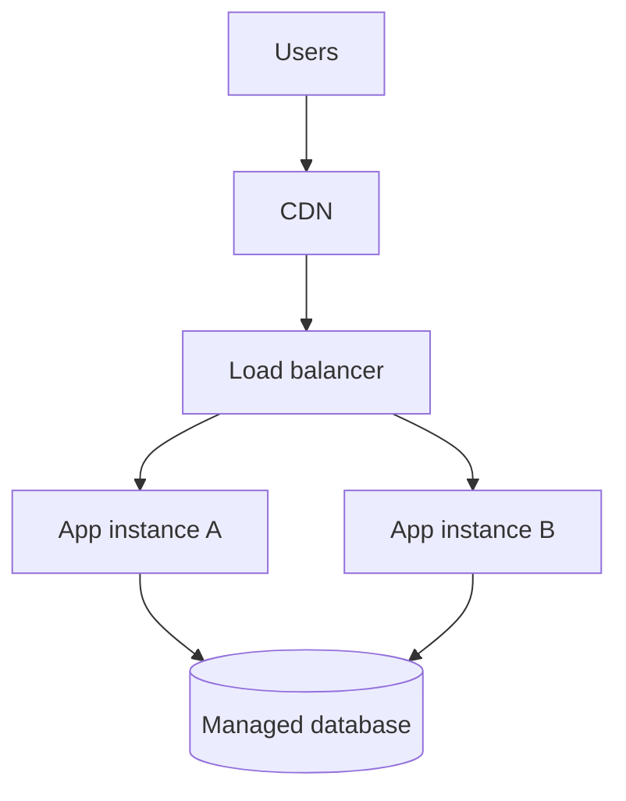

# 06 — Cloud & Infrastructure

[← Learning index](../README.md)

## Cloud computing
Cloud providers compute, storage, databases aur networking on-demand provide karte hain. Benefits: fast provisioning aur flexible scaling. Risks: unexpected cost, outages, security misconfiguration aur vendor dependence.

## IaaS, PaaS, SaaS
- IaaS: virtual servers, disks, networks.
- PaaS: managed platform/runtime.
- SaaS: ready-to-use application.
Service ke hisaab se provider aur customer ki responsibilities change hoti hain.

## Regions and availability zones
Region geographic area hota hai; availability zones isolated infrastructure locations ho sakti hain. Multiple zones resilience improve kar sakti hain, lekin app aur data design bhi failure-ready hona chahiye.

## CDN and caching
CDN users ke paas edge locations se content deliver karta hai. Cache frequently used data temporarily store karta hai, latency aur backend load kam karne ke liye. Example: website images CDN se load hon; product list cache ho. Stale data/invalidation plan karo.

## DNS, domains, TLS/HTTPS
DNS domain ko network records se resolve karta hai. TLS connection encrypt karta hai aur certificate ke through server identity verify karne mein help karta hai. HTTPS websites ke liye important hai.

## Cloud cost management
Budgets, alerts, resource tags, rightsizing aur unused resource cleanup use karo. Sirf compute price nahi, data transfer, support aur reliability costs bhi compare karo.

## Practice
1. IaaS, PaaS, SaaS ke examples do.
2. CDN aur cache ka difference samjhao.
3. Cloud bill achanak badhe to kya investigate karoge?

## Visual example (diagram)

**Cloud application layout** — is simplified flow ko real system ke example ki tarah dekhein.

## Practical deep dive: cloud infrastructure kaise choose karein?

### Cloud ke main building blocks
- **Compute:** code chalane ki capacity—virtual machines, containers, serverless functions.
- **Storage:** files, backups, object storage, block storage.
- **Database:** structured ya unstructured application data.
- **Networking:** private networks, routing, load balancers, DNS aur connectivity.
- **Identity and access:** kaun resource access kar sakta hai.
- **Observability:** logs, metrics aur traces.
- **Cost controls:** budgets, tags, usage reports aur alerts.

### Deployment options
| Option | Simple meaning | Useful when | Trade-off |
|---|---|---|---|
| Virtual machine | Rented virtual computer | OS-level control chahiye | OS patching aur capacity manage karni hoti hai |
| Container | App aur dependencies ka packaged unit | Repeatable deployments chahiye | Container platform aur image security manage karni hoti hai |
| Managed platform | Provider runtime/operations ka hissa manage karta hai | Team infra work kam karna chahe | Platform constraints aur vendor dependency ho sakti hai |
| Serverless function | Event/request par code run hota hai | Event-driven, variable workloads | Runtime limits, cold starts aur monitoring consider karo |

Serverless ka matlab servers exist nahi karte nahi; infrastructure ka kaafi management provider karta hai.

### Shared responsibility
Provider physical data centre aur managed service ke kuch controls sambhal sakta hai. Customer ki responsibility mein identity permissions, data classification, application configuration aur service ke mutabiq patching aa sakti hai. Exact boundary service model aur contract se verify karo.

### Mini case: small business website
1. Static content ko CDN/object storage se serve karne ka option evaluate karo.
2. Dynamic orders ke liye backend aur managed database consider karo.
3. Secrets ko environment/secret manager mein rakho.
4. Least privilege access, HTTPS, backups aur monitoring configure karo.
5. Expected traffic aur recovery needs ke basis par capacity aur budget set karo.
6. Deployment se pehle restore test aur rollback plan verify karo.

### Cost-control checklist
- Unused resources identify karo.
- Storage growth aur data transfer costs track karo.
- Non-production resources ko schedule/stop karne ka safe plan banao.
- Budgets aur alerts set karo.
- Logs/metrics retention ko business need ke hisaab se tune karo.
- Sirf lowest price nahi—availability, support, security aur migration cost bhi compare karo.

### Practice lab
Ek demo app ke liye architecture diagram banao. Har component ke liye purpose, data sensitivity, access permissions, backup/restore approach, monthly cost driver aur failure impact likho.

### Knowledge check
1. Cloud use karne par security ki saari responsibility provider ki ho jati hai? **Nahi.**
2. VM aur managed platform ka key trade-off?
3. Backup create karna aur restore test karna dono kyun zaroori hain?
4. Cloud cost sirf compute bill hota hai? **Nahi**—storage, network, managed services aur support bhi cost ho sakte hain.

### Further learning
- [AWS Well-Architected](https://aws.amazon.com/architecture/well-architected/)
- [Microsoft Azure Architecture Center](https://learn.microsoft.com/en-us/azure/architecture/)
- [Google Cloud Architecture Framework](https://cloud.google.com/architecture/framework)

## Quick answer guide
1. No. Customers still manage responsibilities such as identity, data, application configuration and some patching depending on the service.
2. A VM gives more OS control but needs more maintenance; a managed platform reduces some operations but may impose platform limits.
3. A backup that has never been restored may be incomplete, corrupt or unusable when needed.
4. Cloud costs can include compute, storage, network transfer, managed services, support and operational work.

## Review status
- Content milestone: practical beginner expansion.
- Verification status: not yet independently deep-reviewed.
- Last content expansion: 2026-10-30.
- Next review: add a worked cloud deployment diagram and verify provider-specific examples.

## Mini architecture decision record: host a small business site

**Context:** A mostly static public website with a small contact form and occasional content updates.

**Option A — one virtual machine:** flexible runtime control, but the team manages OS patching, web server, backups and availability design.

**Option B — managed static hosting/CDN plus a small server-side form handler:** often reduces operations for static content, but introduces provider constraints and the form endpoint still needs validation, spam controls and monitoring.

**Option C — full container platform:** can fit a more complex application, but may add unnecessary operational overhead for a simple site.

**Decision method:** compare expected traffic, team skills, data sensitivity, support needs, availability target, cost, migration/exit path and required backend behaviour. Do not select a platform only because it is popular.

## Lab review checklist
A strong architecture diagram labels each component's purpose, trust boundary, access permissions, data sensitivity, backup/restore method, cost driver and failure impact. The hosting decision should compare at least two viable options and explain why the simplest option that meets requirements was chosen. Include a budget alert and a tested recovery step.
