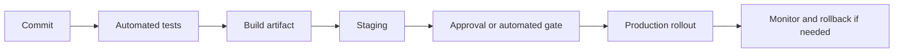

# 07 — DevOps & Reliability

[← Learning index](../README.md)

## DevOps
DevOps development aur operations ke beech collaboration, automation aur feedback improve karne wali practices hain. Goal reliable software ko safely deliver karna hai.

## Git and version control
Git code history rakhta hai. Branches parallel work mein help karti hain; pull requests review aur discussion ka path deti hain. Typical workflow: branch → changes → tests → review → merge → deploy.

## Containers
Container app aur dependencies ko portable package mein run karta hai. Virtual machines apna guest operating system run karti hain; common Linux containers host kernel share karte hain.

## CI/CD
Pipeline code build, lint, tests, security checks aur deployment automate kar sakti hai. Secrets ko logs mein expose na hone do aur production permissions restrict karo.

## Metrics, logs, traces
- Metrics: numeric signals, jaise latency, CPU aur error rate.
- Logs: events aur details.
- Traces: request ka path multiple services mein.
Alerts actionable hon, owner aur runbook ke saath.

## Backup and recovery
Backup data ki copy hai; disaster recovery service restore plan hai. RPO acceptable data-loss window aur RTO target restore time describe karte hain. Backup ko restore karke test bhi karo.

## Incident response
Detect → assess → communicate → mitigate → restore → learn. Postmortem ka focus systems/processes improve karna hona chahiye, blame karna nahi.

## Practice
1. Metrics, logs aur traces compare karo.
2. Backup hone par bhi restore test kyun zaroori hai?
3. Production incident ke first steps likho.

## Visual example (diagram)

**CI/CD pipeline** — is simplified flow ko real system ke example ki tarah dekhein.

### Real-world reference image: Kubernetes cluster architecture

Source: [Kubernetes official architecture documentation](https://kubernetes.io/docs/concepts/architecture/). Control plane, worker nodes aur workloads ke roles identify karein.

## Practical deep dive: code se reliable release tak

### CI/CD ka simple flow
1. Developer change commit karta hai.
2. Automated pipeline code style, tests aur security checks run karti hai.
3. Build artifact create hota hai.
4. Artifact test/staging environment mein deploy hota hai.
5. Required approvals aur release checks complete hote hain.
6. Production rollout controlled tareeke se hota hai.
7. Metrics, logs aur alerts se health monitor hoti hai.

CI/CD ka goal sirf fast deploy karna nahi; repeatable, traceable aur recoverable delivery banana hai.

### Deployment strategies
- **Rolling:** instances ko batches mein update karna.
- **Blue/green:** old aur new environment ke beech traffic switch karna.
- **Canary:** chhote user/traffic segment se start karke gradually expand karna.
- **Feature flag:** code deploy ho sakta hai, feature ko controlled tareeke se enable/disable kiya ja sakta hai.

Har strategy ki cost, state/data migration risk aur rollback limitations hain. Database changes ko old aur new app versions ke saath compatible rakhna aksar critical hota hai.

### Monitoring vs logs vs traces
- **Metrics:** numeric trends, jaise error rate aur latency.
- **Logs:** events aur context ka record.
- **Traces:** ek request ke multiple services se guzarne ka path.
In teeno ko correlation IDs aur useful dashboards se connect karna incident diagnosis ko easy bana sakta hai. Sensitive data logs mein mat daalo.

### SLI, SLO aur SLA
- **SLI:** reliability measure, jaise successful requests ka proportion.
- **SLO:** internal/contractual target, defined measurement window ke saath.
- **SLA:** customer-facing agreement, jisme commitments aur possible consequences ho sakte hain.
Exact definitions organization ke documents mein verify karo; terms ko interchangeably use na karo.

### Incident response mini-playbook
1. Impact aur affected users identify karo.
2. Incident owner aur communication channel set karo.
3. Immediate mitigation choose karo—rollback, traffic shift, disable feature, etc.
4. Evidence preserve karo aur status updates do.
5. Recovery verify karo.
6. Blameless postmortem mein contributing factors, detection gaps aur actionable follow-ups record karo.

### Practice lab
Demo app ke liye release checklist, 3 service metrics, 2 alert rules, rollback criteria aur one-page incident report template likho. Alert aisa ho jo actionable ho; har log line par alert banana noise create karta hai.

### Further learning
- [Google SRE Book](https://sre.google/sre-book/table-of-contents/)
- [DORA](https://dora.dev/)
- [OpenTelemetry Documentation](https://opentelemetry.io/docs/)
