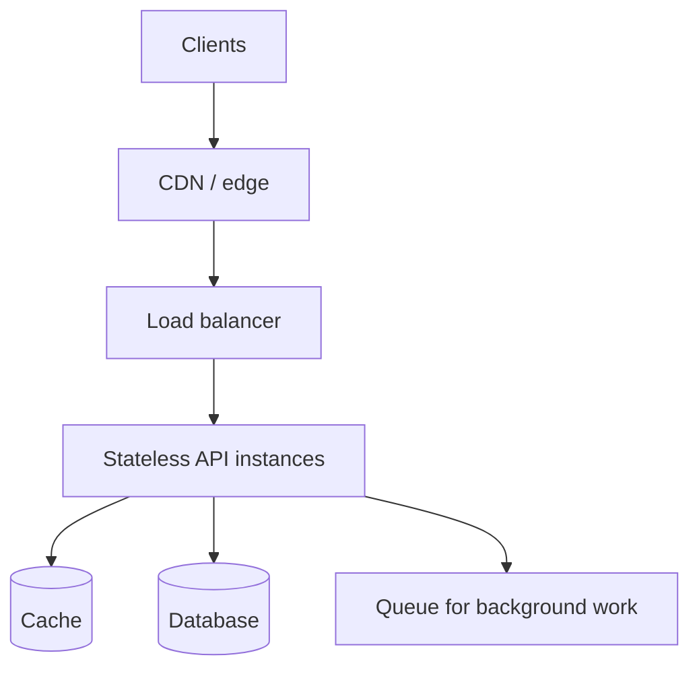

# 08 — System Design & Architecture

[← Learning index](../README.md)

## System design
Business requirements ko services, data storage, APIs, scaling, security aur failure handling mein translate karna system design hai. Pehle functional aur non-functional requirements clear karo.

Example: food delivery system mein customer, restaurant, order, payment aur delivery workflows plan karne hote hain.

## Scalability
Vertical scaling machine ko zyada CPU/RAM dena hai. Horizontal scaling multiple instances add karna hai. Stateless services horizontal scale karna comparatively easy ho sakta hai; database bottlenecks alag solve karne padte hain.

## Load balancing
Load balancer requests ko healthy server instances mein distribute karta hai. Health checks, timeouts, retries aur session behavior design karna hota hai. Example: 3 web servers ke peeche load balancer; unhealthy server ko traffic na mile.

## Monolith vs microservices
Monolith ek deployable application hai; small systems ke liye simpler ho sakta hai. Microservices independently deployable services hoti hain, lekin network failures, observability, data consistency aur operations complexity badhati hain. Microservices automatically better nahi hain.

## Multi-tenant systems
Ek application multiple organizations/customers serve karti hai. Tenant isolation, authorization, data partitioning, configuration aur billing carefully design karo. Example: HR SaaS mein Company A ka user Company B ke employee records access na kar sake.

## Caching, queues and CDN
Cache repeated reads fast kar sakta hai. Queue background jobs ko decouple karti hai. CDN static content users ke paas deliver karta hai. Failure modes aur stale data behavior define karo.

## Architecture trade-offs
Cost vs latency, consistency vs availability aur simplicity vs flexibility trade-offs hain. Workload measure karo; bottleneck prove hone se pehle unnecessary complexity add mat karo.

## Practice
1. Vertical aur horizontal scaling compare karo.
2. Multi-tenant data isolation ke 3 controls batao.
3. Startup ke liye monolith kab sensible ho sakta hai?

## Visual example (diagram)

**Scalable request path** — is simplified flow ko real system ke example ki tarah dekhein.

### Real-world reference image: Kubernetes cluster architecture

Source: [Kubernetes official architecture documentation](https://kubernetes.io/docs/concepts/architecture/). Control plane, worker nodes aur workloads ke roles identify karein.

## Practical deep dive: system design kaise sochte hain?

System design ka matlab components draw karna bhar nahi. Pehle problem, scale, data, constraints, risks aur operational needs samjho.

### Design se pehle sawal
1. Kaun use karega aur kaun se core workflows hain?
2. Approximate users, request rate, data volume aur growth kya hai?
3. Availability, latency aur recovery expectations kya hain?
4. Data sensitive hai? Tenant isolation ya compliance needs hain?
5. Budget, team skills aur delivery deadline kya hain?
6. Failure hone par user ko kya behaviour dikhna chahiye?

### Basic building blocks
- Client/frontend
- DNS/CDN and edge caching
- Load balancer or API gateway
- Application services
- Database and cache
- Queue/background workers
- Object/file storage
- Identity provider
- Logs, metrics, traces and alerting

Har app ko har component ki zaroorat nahi. Simple modular monolith, carefully designed, chhote product ke liye microservices se behtar ho sakta hai.

### Common trade-offs
- **Cache:** latency aur database load reduce kar sakta hai, lekin stale data aur invalidation complexity laata hai.
- **Replication:** read availability/capacity improve kar sakti hai, lekin lag aur consistency trade-offs hote hain.
- **Partitioning/sharding:** large datasets distribute kar sakta hai, lekin queries aur operations complex banata hai.
- **Queues:** background work aur traffic bursts absorb kar sakti hain, lekin eventual completion, retries aur duplicate processing handle karni hoti hai.
- **Microservices:** independent ownership/deployment enable kar sakte hain, lekin network failures, observability aur distributed data complexity badhate hain.

### Back-of-the-envelope estimation
Rough estimate se order of magnitude samajhne ki koshish karo:
- Daily requests ÷ 86,400 ≈ average requests per second.
- Peak traffic average se kaafi zyada ho sakta hai, isliye peak factor explicitly assume karo.
- Stored data estimate mein records/day × average record size × retention days consider karo; indexes, replicas aur backups extra space lete hain.
Ye estimates initial planning ke liye hain; real metrics se validate karna zaroori hai.

### Practice lab
Ek ticket-booking system ka high-level diagram banao. Double booking, traffic spike, database outage aur delayed email ke failure cases likho. Har case ke liye prevention, detection aur recovery approach explain karo.

### Further learning
- [AWS Well-Architected](https://aws.amazon.com/architecture/well-architected/)
- [Google SRE Book](https://sre.google/sre-book/table-of-contents/)
