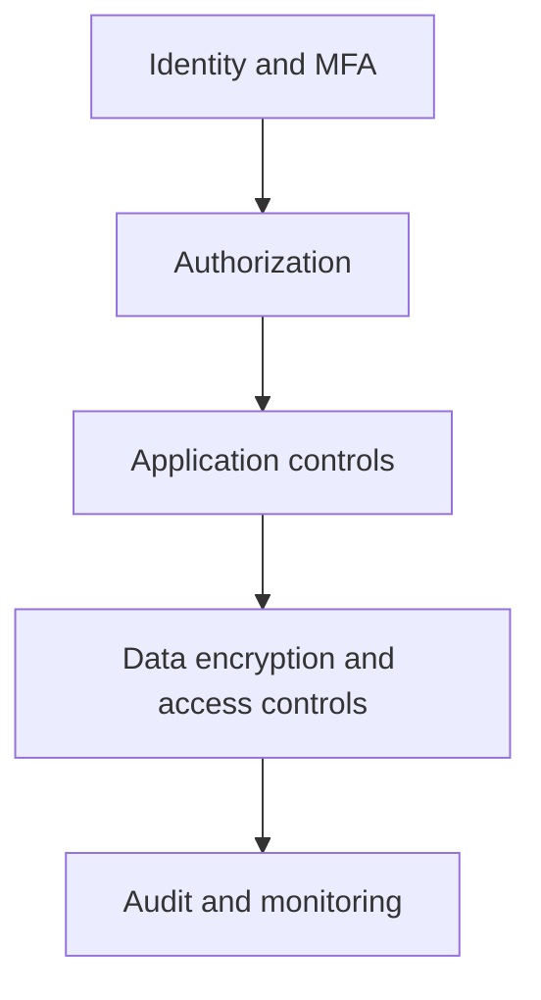

# 09 — Cybersecurity & Privacy

[← Learning index](../README.md)

## CIA triad
- Confidentiality: data sirf authorized users ko mile.
- Integrity: unauthorized changes se protection.
- Availability: service zaroorat par accessible ho.
Example: payroll permissions confidentiality, audit trails integrity aur tested backups recovery support karte hain.

## Authentication, authorization, least privilege
Authentication identity verify karti hai. Authorization permissions enforce karti hai. Least privilege ka matlab sirf required access dena hai. Admin accounts aur production access tightly control karo.

## Encryption and secrets
Encryption data in transit/at rest protect kar sakti hai. API keys, passwords aur tokens ko source code ya public repositories mein hardcode mat karo. Approved secret manager use karo aur access/rotation review karo.

## Secure coding
- Input validate aur output appropriately encode karo.
- Parameterized database queries use karo.
- Access control server-side enforce karo.
- Dependencies update/scan karo.
- Errors mein secrets/internal details expose mat karo.
- Backups aur recovery test rakho.

## Common web risks
Injection, broken access control, authentication failures, security misconfiguration aur vulnerable dependencies common risks hain. Security tests ko development/release process ka part banao.

## Privacy
Sirf necessary personal data collect karo; purpose, access, retention aur deletion define karo. Applicable laws/policies follow karo. Sensitive data ko logs ya analytics mein unnecessary include na karo.

## Practice
1. CIA triad ke office examples do.
2. API key repository mein rakhna unsafe kyun hai?
3. Least privilege ka example likho.

## Visual example (diagram)

**Defense in depth** — is simplified flow ko real system ke example ki tarah dekhein.

## Practical deep dive: security ko project mein kaise include karein?

### Security goals
- **Confidentiality:** data sirf authorized people/systems ko mile.
- **Integrity:** data unauthorized tareeke se change na ho.
- **Availability:** system zaroorat par accessible rahe.
Ye common CIA triad hai; real systems mein authenticity, accountability aur privacy bhi important hote hain.

### Authentication vs authorization
- **Authentication:** aap kaun ho?
- **Authorization:** aapko kya karne ki permission hai?
Successful login ka matlab har record ya admin action ka access nahi.

### Threat modelling — beginner method
1. Assets identify karo: accounts, personal data, payment records, secrets.
2. Entry points aur data flows draw karo.
3. Threats socho: account takeover, injection, data leakage, privilege misuse, service disruption.
4. Existing controls aur gaps likho.
5. Risk ke hisaab se mitigation prioritize karo.
6. Tests aur owner assign karo.

### Practical controls
- Unique accounts, MFA where appropriate, least privilege.
- HTTPS and suitable encryption/key management.
- Server-side input validation and parameterized database queries.
- Secrets manager/environment configuration; secrets Git repository mein nahi.
- Dependency updates and vulnerability scanning.
- Backups plus restore tests.
- Access/audit logs with restricted access and retention limits.
- Incident reporting, patching and recovery procedures.
- Data minimization: jo data chahiye hi nahi, use collect na karo.

### Privacy-by-design example
Signup form mein sirf required details lo. Purpose aur retention period define karo. Support staff ko sirf required records ka access do. Export/delete requests aur legal retention obligations ko applicable law ke hisaab se design karo. Legal requirements country, sector aur data type ke mutabiq vary karte hain.

### Practice lab
Ek employee portal ke liye asset list, 5 threats, risk level, preventive control, detection method aur recovery action ki table banao. Phir login, role permissions, lost-password flow aur account lockout/rate-limit behaviour test plan likho.

### Knowledge check
1. Authentication aur authorization mein difference?
2. Frontend mein API key rakhna risky kyun?
3. Backup security ka replacement hai? **Nahi**—backup recovery mein help karta hai, lekin access control aur protection alag controls hain.
4. Har log ko forever store karna chahiye? **Nahi**—privacy, access, cost aur retention policy matter karte hain.

### Further learning
- [NIST Cybersecurity Framework](https://www.nist.gov/cyberframework)
- [OWASP Top 10](https://owasp.org/projects/top-ten/)
- [CISA Secure by Design](https://www.cisa.gov/securebydesign)

## Quick answer guide
1. Authentication verifies identity; authorization decides what that identity can do.
2. Frontend bundles are inspectable, so embedded secrets can be extracted and abused.
3. Backups aid recovery but do not replace access control, encryption, monitoring or secure configuration.
4. Excessive retention increases privacy exposure, breach impact and storage/management cost.

## Review status
- Content milestone: practical beginner expansion.
- Verification status: not yet independently deep-reviewed.
- Last content expansion: 2026-10-30.
- Next review: map each security section to current OWASP/NIST guidance and add a threat-model worked example.

## Worked threat-model example: employee leave portal

| Asset/flow | Threat | Potential impact | Example control | Evidence to test |
|---|---|---|---|---|
| Leave balance API | User changes employee ID in request | Private data exposure | Server-side object-level authorization | Test user A cannot read user B record |
| Login/session | Stolen session token | Account misuse | Secure cookie/session settings, expiry and revocation | Verify logout/session invalidation policy |
| Approval workflow | Unauthorized approval action | Incorrect leave status | Role and relationship checks on server | Employee role cannot call manager approval API |
| Logs | Sensitive details written to logs | Privacy/security exposure | Structured redaction and restricted log access | Search test logs for secrets/PII |
| Recovery | Ransomware or accidental deletion | Service/data loss | Protected backups and restore drills | Record a successful restore test |

A threat model lists plausible risks; it does not prove a system secure. Prioritize by likelihood, impact and context, then test the controls. Do not use real employee data in a demo lab.

### Version note for OWASP references
The official OWASP Top 10 project page lists **OWASP Top 10:2025** as the current released version at the time this chapter was checked (2026-10-30). Use the project's versioned documentation when studying a specific release. The Top 10 is an awareness document, not a complete security test plan or proof of compliance.
