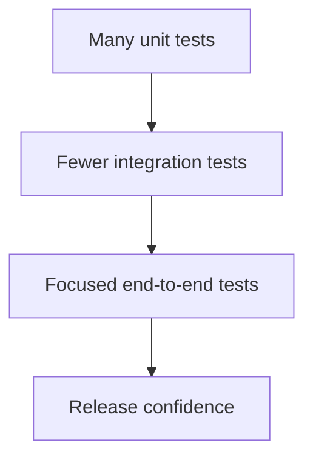

# 10 — Testing & Software Quality

**Project:** Software & IT Services — Deep Research & Study Notes  
**Owner / Content Creator:** Sandeep Barupal  
**Copyright:** © 2026 Sandeep Barupal. All rights reserved, except as stated below.

[← Learning index](../README.md)

## Testing kyun?
Testing expected behavior verify karti hai aur regressions pakadti hai. Testing risk reduce karti hai, lekin bugs-free hone ki absolute guarantee nahi deti.

## Testing levels
- Unit test: small function/component.
- Integration test: components/services ka interaction.
- End-to-end test: complete user workflow.
- Acceptance test: business requirements satisfy hue ya nahi.
Example: password validator unit test; login API integration test; login-to-dashboard E2E test.

## Manual vs automated testing
Manual testing exploratory checks aur UX feedback mein useful hai. Automated tests repeatable scenarios quickly run karte hain. Strategy risk, cost aur maintenance ko balance kare.

## Regression testing
Regression tests check karte hain ki new changes existing behavior break na karein. Business-critical flows ko priority do.

## Performance testing
Latency, throughput, resource use aur load ke neeche behavior measure karo. Realistic test data use karo; profile karke bottleneck optimize karo.

## Usability and accessibility
Clear labels, helpful errors, keyboard support, responsive layout aur adequate contrast test karo.

## Practice
1. Signup feature ke unit, integration aur E2E test examples do.
2. Automation manual testing ko fully replace kyun nahi karti?
3. Slow page diagnose karne ke steps likho.

## Visual example (diagram)

**Testing pyramid** — is simplified flow ko real system ke example ki tarah dekhein.

## Practical deep dive: quality ko kaise prove karein?

### Test levels
- **Unit test:** chhoti function/component ki logic test.
- **Integration test:** modules ya services milkar sahi kaam karte hain?
- **Contract test:** API producer/consumer agreed interface follow karte hain?
- **End-to-end test:** user ke complete workflow ko realistic environment mein test karna.
- **Performance test:** load, response time, throughput aur resource usage check karna.
- **Accessibility test:** keyboard, semantics, contrast aur assistive technology support check karna.
- **Security test:** defined scope ke andar vulnerabilities aur access controls evaluate karna.

Har test ko UI automation banana zaroori nahi. Fast, stable unit/integration tests aur selected high-value end-to-end tests ka balanced mix useful hota hai.

### Test cases ka structure
Ek useful test case mein preconditions, test data, steps, expected result aur cleanup/rollback steps hote hain.

**Example — password reset**
1. Registered account ke liye reset request bhejo.
2. Response sensitive account details expose na kare.
3. Valid token se password reset verify karo.
4. Expired/used token reject hona chahiye.
5. Rate limiting aur audit event verify karo.
6. Purane sessions ka behaviour defined policy ke mutabiq test karo.

### Defect priority
Severity user/system impact ko describe karti hai; priority batati hai fix kitni jaldi karna chahiye. Dono related hain lekin same concept nahi. Production mein widespread login outage high severity/high priority ho sakta hai; minor typo low severity ho sakta hai.

### Flaky tests aur test data
- Deterministic test data use karo.
- Shared test accounts/data ko parallel runs se conflict na hone do.
- Fixed sleep ke bajaye condition-based waits use karo.
- Flaky tests ko investigate karo; sirf repeatedly rerun karke ignore mat karo.
- Production personal data ko test environment mein copy karne se pehle privacy/security controls evaluate karo.

### Practice lab
Ek shopping cart ke 8 test cases likho: normal add/remove, quantity boundary, empty cart, invalid product, price update, network failure, unauthorized order access aur duplicate submit. Har case ka expected result define karo.

### Further learning
- [ISTQB](https://www.istqb.org/)
- [Playwright Documentation](https://playwright.dev/docs/intro)
- [Web Content Accessibility Guidelines (WCAG)](https://www.w3.org/WAI/standards-guidelines/wcag/)

## Quick answer guide
1. Unit tests check small units; integration tests check boundaries between components; end-to-end tests check complete user workflows.
2. Severity describes impact; priority describes urgency/order of fixing.
3. Flaky tests reduce confidence and waste time; investigate root causes instead of ignoring repeated failures.
4. Automated accessibility tools find some issues but do not replace keyboard, screen-reader and human evaluation.

## Review status
- Content milestone: practical beginner expansion.
- Verification status: not yet independently deep-reviewed.
- Last content expansion: 2026-10-30.
- Next review: add a traceable sample test plan and validate tooling links/commands.

## Worked test design: password reset flow

| Test | Setup/action | Expected result |
|---|---|---|
| Valid request | Registered email requests reset | Generic confirmation; no unnecessary account disclosure |
| Unknown email | Unregistered email requests reset | Similar public response to reduce account enumeration |
| Expired token | Use expired reset token | Reset rejected; user can request a new link |
| Reused token | Use token twice | Second use rejected |
| Weak new password | Submit password violating defined policy | Clear validation error |
| Rate limit | Send repeated requests rapidly | Requests throttled according to policy |
| Unauthorized session | Access reset-only endpoint without valid proof | Request rejected |
| Audit/log review | Run reset test and inspect safe logs | No raw password or reset token recorded |

Actual policy and responses must match the product's security requirements. Tests should use controlled accounts and never real users' passwords.

## Lab review checklist
A strong test plan maps each requirement to at least one test, includes positive, negative, boundary and permission cases, and states test data and expected results. Test failures should be reproducible and defects should include steps/evidence. Accessibility checks should include keyboard operation and a manual review, not only an automated scan.
