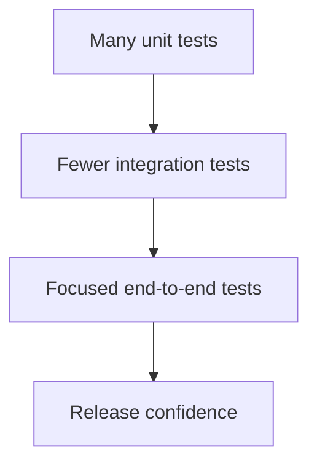

# 10 — Testing & Software Quality

[← Learning index](../README.md)

## Testing kyun?
Testing expected behavior verify karti hai aur regressions pakadti hai. Testing risk reduce karti hai, lekin bugs-free hone ki absolute guarantee nahi deti.

## Testing levels
- Unit test: small function/component.
- Integration test: components/services ka interaction.
- End-to-end test: complete user workflow.
- Acceptance test: business requirements satisfy hue ya nahi.
Example: password validator unit test; login API integration test; login-to-dashboard E2E test.

## Manual vs automated testing
Manual testing exploratory checks aur UX feedback mein useful hai. Automated tests repeatable scenarios quickly run karte hain. Strategy risk, cost aur maintenance ko balance kare.

## Regression testing
Regression tests check karte hain ki new changes existing behavior break na karein. Business-critical flows ko priority do.

## Performance testing
Latency, throughput, resource use aur load ke neeche behavior measure karo. Realistic test data use karo; profile karke bottleneck optimize karo.

## Usability and accessibility
Clear labels, helpful errors, keyboard support, responsive layout aur adequate contrast test karo.

## Practice
1. Signup feature ke unit, integration aur E2E test examples do.
2. Automation manual testing ko fully replace kyun nahi karti?
3. Slow page diagnose karne ke steps likho.

## Visual example (diagram)

**Testing pyramid** — is simplified flow ko real system ke example ki tarah dekhein.

