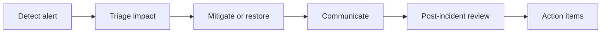

# 11 — IT Operations & Service Management

[← Learning index](../README.md)

## Help desk and incident management
Help desk users ke issues receive, classify, track aur resolve karta hai. Incident service interruption/degradation hai. Priority business impact aur urgency se decide hoti hai.

Example: email outage ko ticket, owner, status updates aur resolution notes ke saath manage karna.

## Incident vs problem vs change
- Incident: service restore karna.
- Problem: underlying cause identify aur repeat incidents prevent karna.
- Change: system mein controlled modification.

## SLA, SLO, KPI
- SLA: customer ke saath service commitment.
- SLO: performance/availability target.
- KPI: performance measure.
Measurement window aur exclusions clear define karo.

## Asset management
Hardware, software licenses, owners, lifecycle, warranties aur compliance track karo. Accurate inventory security aur cost control mein help karti hai.

## Change management
Risk assessment, testing, approvals where required, communication, maintenance window, backup aur rollback plan changes safer banate hain.

## Practice
1. Incident aur problem ka difference example se batao.
2. Production change checklist banao.
3. Asset inventory mein kaun se fields hone chahiye?

## Visual example (diagram)

**Incident response loop** — is simplified flow ko real system ke example ki tarah dekhein.

## Practical deep dive: IT operations aur support

### Common ITSM work types
- **Incident:** service unexpected tareeke se break/degrade hui; service restore karna focus hai.
- **Problem:** incidents ke underlying cause ko identify/reduce karna.
- **Change:** system mein controlled modification, risk assessment aur approval process ke saath.
- **Service request:** standard request, jaise approved software access.
- **Asset management:** devices/licenses/resources ka lifecycle record.
- **Knowledge management:** reusable troubleshooting instructions aur known solutions.

Exact processes organization ke scale aur risk ke mutabiq lightweight ya formal ho sakte hain.

### Incident triage
1. User impact, urgency aur scope identify karo.
2. Reproducible symptoms aur recent changes note karo.
3. Safe initial checks karo; evidence delete/overwrite na karo.
4. Right owner/team ko escalate karo.
5. Status updates aur next update time communicate karo.
6. Recovery ke baad user se verify karo aur notes update karo.

### Good support ticket
- Clear title and impact
- Affected service/device and time
- Exact error text, safe screenshots/logs
- Steps to reproduce
- What changed recently
- Actions already tried
- Sensitive data/credentials redacted

Password, authentication token ya unnecessary personal information ticket mein paste mat karo.

### Runbook kya hota hai?
Runbook tested steps ka document hai jo routine task ya incident handle karne mein help karta hai. Ismein purpose, prerequisites, permissions, steps, verification, failure/rollback path aur escalation contact hona chahiye. Runbook ko real incident se pehle safe environment mein test karna chahiye.

### Practice lab
“Employee cannot access company email” ke liye ticket template aur runbook banao. Identity verification, service status, device/network checks, escalation aur closure confirmation include karo—security controls bypass na karo.

### Further learning
- [Atlassian ITSM guide](https://www.atlassian.com/itsm)
- [Google SRE Book](https://sre.google/sre-book/table-of-contents/)
