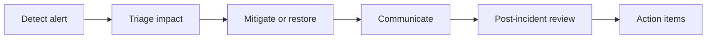

# 11 — IT Operations & Service Management

[← Learning index](../README.md)

## Help desk and incident management
Help desk users ke issues receive, classify, track aur resolve karta hai. Incident service interruption/degradation hai. Priority business impact aur urgency se decide hoti hai.

Example: email outage ko ticket, owner, status updates aur resolution notes ke saath manage karna.

## Incident vs problem vs change
- Incident: service restore karna.
- Problem: underlying cause identify aur repeat incidents prevent karna.
- Change: system mein controlled modification.

## SLA, SLO, KPI
- SLA: customer ke saath service commitment.
- SLO: performance/availability target.
- KPI: performance measure.
Measurement window aur exclusions clear define karo.

## Asset management
Hardware, software licenses, owners, lifecycle, warranties aur compliance track karo. Accurate inventory security aur cost control mein help karti hai.

## Change management
Risk assessment, testing, approvals where required, communication, maintenance window, backup aur rollback plan changes safer banate hain.

## Practice
1. Incident aur problem ka difference example se batao.
2. Production change checklist banao.
3. Asset inventory mein kaun se fields hone chahiye?

## Visual example (diagram)

**Incident response loop** — is simplified flow ko real system ke example ki tarah dekhein.

