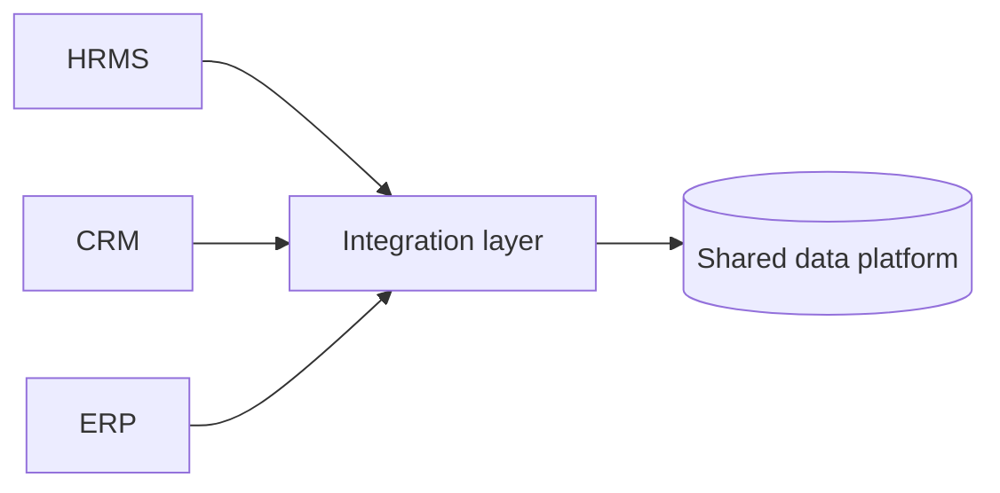

# 12 — Enterprise Applications & Data

[← Learning index](../README.md)

## Enterprise software
Enterprise applications large business workflows support karti hain. Permissions, auditability, integration, reliability aur configuration important hote hain.

## ERP, CRM, HRMS
- ERP: finance, inventory, procurement aur operations.
- CRM: customers, sales pipeline aur interactions.
- HRMS: employee records, attendance, leave aur payroll-related workflows.
Capabilities vendor ke hisaab se vary karti hain.

## Data warehouse and BI
Operational systems daily transactions handle karte hain. Data warehouse reporting/analysis ke liye multiple sources ka historical data combine kar sakta hai. BI dashboards trends aur metrics show karte hain.

Example: monthly dashboard regions ke revenue, returns aur customer growth compare karta hai.

## Integration
Enterprise systems APIs, events, files ya connectors se data exchange karte hain. Data mapping, retries, duplicate events, access controls aur reconciliation plan karo.

## Legacy modernization
Options: existing system maintain karna, API ke through wrap karna, components refactor/migrate karna ya replace karna. Big-bang replacement risky ho sakta hai; phased migration useful ho sakti hai.

## Practice
1. ERP, CRM aur HRMS compare karo.
2. Reporting ke liye historical data kyun useful hai?
3. Legacy system replace karne ke 5 risks likho.

## Visual example (diagram)

**Enterprise system integration** — is simplified flow ko real system ke example ki tarah dekhein.

