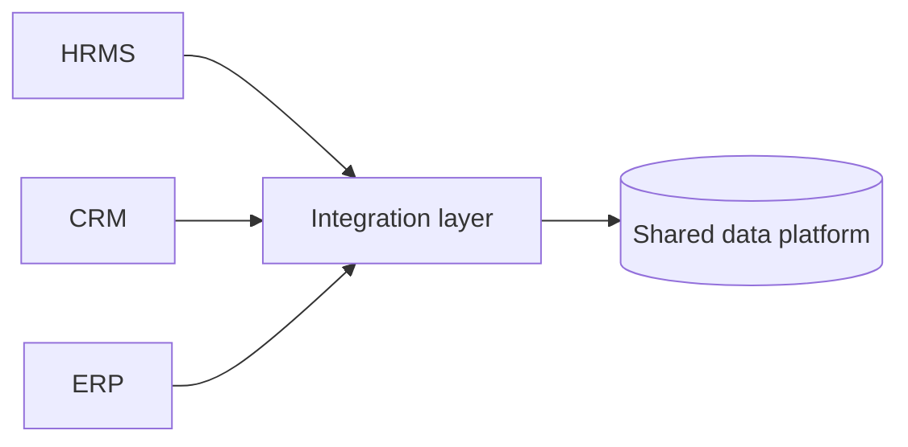

# 12 — Enterprise Applications & Data

[← Learning index](../README.md)

## Enterprise software
Enterprise applications large business workflows support karti hain. Permissions, auditability, integration, reliability aur configuration important hote hain.

## ERP, CRM, HRMS
- ERP: finance, inventory, procurement aur operations.
- CRM: customers, sales pipeline aur interactions.
- HRMS: employee records, attendance, leave aur payroll-related workflows.
Capabilities vendor ke hisaab se vary karti hain.

## Data warehouse and BI
Operational systems daily transactions handle karte hain. Data warehouse reporting/analysis ke liye multiple sources ka historical data combine kar sakta hai. BI dashboards trends aur metrics show karte hain.

Example: monthly dashboard regions ke revenue, returns aur customer growth compare karta hai.

## Integration
Enterprise systems APIs, events, files ya connectors se data exchange karte hain. Data mapping, retries, duplicate events, access controls aur reconciliation plan karo.

## Legacy modernization
Options: existing system maintain karna, API ke through wrap karna, components refactor/migrate karna ya replace karna. Big-bang replacement risky ho sakta hai; phased migration useful ho sakti hai.

## Practice
1. ERP, CRM aur HRMS compare karo.
2. Reporting ke liye historical data kyun useful hai?
3. Legacy system replace karne ke 5 risks likho.

## Visual example (diagram)

**Enterprise system integration** — is simplified flow ko real system ke example ki tarah dekhein.

## Practical deep dive: enterprise applications

### Common systems
- **ERP:** finance, purchasing, inventory aur operations ko connect kar sakta hai.
- **CRM:** customer, sales aur relationship records manage karta hai.
- **HRMS/HCM:** employee lifecycle, leave, payroll-related workflows.
- **CMS:** digital content manage/publish karta hai.
- **DMS:** documents, versions, access aur retention.
- **BI:** data ko reports/dashboards mein convert karta hai.
- **Workflow/BPM:** approvals aur repeatable business processes coordinate karta hai.

Products ke exact features vendor aur configuration par depend karte hain.

### Buy, build or configure?
1. **Buy:** existing product use karo; speed aur vendor support mil sakta hai, par fit/licensing limits ho sakti hain.
2. **Build:** custom software; tailored fit, lekin maintenance aur ownership cost aapki.
3. **Configure/extend:** existing platform ko adapt karo; customization limits aur upgrade compatibility consider karo.

Decision mein business fit, total cost of ownership, integration, security, data export, vendor exit aur staff training include karo.

### Implementation lifecycle
Discovery → process mapping → data cleanup → configuration → integration → migration rehearsal → user acceptance testing → training → cutover → hypercare/support → continuous improvement.

Data migration mein field mapping, duplicate detection, record counts, totals/reconciliation, access controls aur rollback/restore plan zaroori hote hain.

### Mini case: HR leave system
Employee, manager, HR aur payroll ki permissions alag define karo. Approval rules, public holidays, time zones, audit trail, export access aur employee exit process test karo. Salary ya personal data ko demo screenshots mein expose na karo.

### Practice lab
Ek small business ke liye CRM ya HRMS selection matrix banao: required features, integration, cost, data export, access control, support, accessibility, migration effort aur vendor exit plan. Har criterion ko weight dene ka reason likho.

### Further learning
- [NIST Privacy Framework](https://www.nist.gov/privacy-framework)
- [NIST Cybersecurity Framework](https://www.nist.gov/cyberframework)

## Quick answer guide
1. ERP connects core business processes; CRM focuses on customer and sales relationships; HRMS supports employee lifecycle workflows.
2. Buy can speed delivery but may constrain fit; build offers control but creates ongoing maintenance ownership; configure/extend sits between them.
3. Data migration needs mapping, validation, reconciliation, access controls and a recovery plan.
4. User acceptance testing checks whether real business workflows satisfy agreed needs before launch.

## Review status
- Content milestone: practical beginner expansion.
- Verification status: not yet independently deep-reviewed.
- Last content expansion: 2026-10-30.
- Next review: add a vendor-selection worked example and map enterprise systems/integration topics to the master checklist.

## Worked vendor comparison matrix

A small company compares two HR systems. Scores below are placeholders to demonstrate the method, not real vendor ratings.

| Criterion | Weight | Vendor A (example score / 5) | Vendor B (example score / 5) |
|---|---:|---:|---:|
| Required workflows | 25% | 4 | 3 |
| Security/access controls | 20% | 4 | 4 |
| Integration fit | 15% | 3 | 5 |
| Data export/exit | 15% | 4 | 2 |
| Total cost of ownership | 15% | 3 | 4 |
| Accessibility/support | 10% | 4 | 3 |

Calculate weighted scores only after agreeing what each score means. A weak score on a mandatory security or legal requirement may disqualify an option regardless of the total. Ask vendors for evidence, not just yes/no marketing answers.
