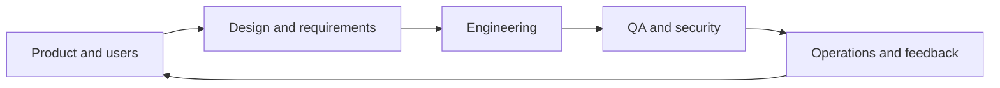

# 13 — Teams, Careers & Emerging Technology

[← Learning index](../README.md)

## Software team roles
- Product manager/owner: outcomes aur priorities.
- Business analyst: requirements/workflows.
- UX/UI designer: user flows aur interface.
- Developer: software build/maintain.
- QA engineer: quality risks aur tests.
- DevOps/SRE: delivery, reliability, automation, operations.
- Security specialist: threats aur controls.
Roles organizations mein overlap kar sakte hain.

## Documentation
Useful docs: requirements, architecture diagrams, API contracts, setup instructions, decision records, runbooks aur incident notes. Docs concise, accurate aur maintained honi chahiye.

## Portfolio and career growth
Portfolio mein problem statement, demo/screenshots, setup steps, key decisions, tests aur limitations show karo. Apne project ke decisions explain karna copied tutorial se zyada useful hai.

Project ideas: expense tracker, leave-management app, inventory dashboard, API-based weather app aur task board.

## AI in software
AI coding suggestions, test-case ideas, documentation drafts aur search mein help kar sakta hai. Output verify karo, tests run karo aur private data/secrets unapproved tools mein paste mat karo.

## PWA and offline-first
Progressive Web App browser-based app ko installability, caching aur selected offline experiences de sakti hai. Offline changes sync, stale data aur conflicts plan karne hote hain.

## Project planning
Scope, assumptions, risks, dependencies, owners, acceptance criteria aur milestones define karo. Work small deliverables mein split karo aur blockers early communicate karo.

## Professional practice
Version control, code review, tests, secret safety, rollback planning aur completion evidence (tests/demo/screenshots) use karo.

## Practice
1. Portfolio project choose karke features aur acceptance criteria likho.
2. AI-generated code merge karne se pehle checks list karo.
3. Weekly learning plan banao: concept, hands-on task, revision.

## Visual example (diagram)

**Product delivery team** — is simplified flow ko real system ke example ki tarah dekhein.

