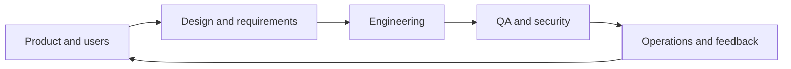

# 13 — Teams, Careers & Emerging Technology

[← Learning index](../README.md)

## Software team roles
- Product manager/owner: outcomes aur priorities.
- Business analyst: requirements/workflows.
- UX/UI designer: user flows aur interface.
- Developer: software build/maintain.
- QA engineer: quality risks aur tests.
- DevOps/SRE: delivery, reliability, automation, operations.
- Security specialist: threats aur controls.
Roles organizations mein overlap kar sakte hain.

## Documentation
Useful docs: requirements, architecture diagrams, API contracts, setup instructions, decision records, runbooks aur incident notes. Docs concise, accurate aur maintained honi chahiye.

## Portfolio and career growth
Portfolio mein problem statement, demo/screenshots, setup steps, key decisions, tests aur limitations show karo. Apne project ke decisions explain karna copied tutorial se zyada useful hai.

Project ideas: expense tracker, leave-management app, inventory dashboard, API-based weather app aur task board.

## AI in software
AI coding suggestions, test-case ideas, documentation drafts aur search mein help kar sakta hai. Output verify karo, tests run karo aur private data/secrets unapproved tools mein paste mat karo.

## PWA and offline-first
Progressive Web App browser-based app ko installability, caching aur selected offline experiences de sakti hai. Offline changes sync, stale data aur conflicts plan karne hote hain.

## Project planning
Scope, assumptions, risks, dependencies, owners, acceptance criteria aur milestones define karo. Work small deliverables mein split karo aur blockers early communicate karo.

## Professional practice
Version control, code review, tests, secret safety, rollback planning aur completion evidence (tests/demo/screenshots) use karo.

## Practice
1. Portfolio project choose karke features aur acceptance criteria likho.
2. AI-generated code merge karne se pehle checks list karo.
3. Weekly learning plan banao: concept, hands-on task, revision.

## Visual example (diagram)

**Product delivery team** — is simplified flow ko real system ke example ki tarah dekhein.

## Practical deep dive: IT roles, teamwork aur professional growth

### Roles ka simple map
- **Frontend/backend/full-stack engineer:** user experience, server logic ya dono.
- **QA engineer:** quality strategy aur defect prevention/detection.
- **Platform/DevOps engineer:** developer workflows, infrastructure aur delivery automation.
- **SRE/operations:** reliability, incidents aur operational toil reduce karna.
- **Security engineer:** threat reduction, secure design aur response.
- **Data engineer/analyst/scientist:** data pipelines, reporting, analysis aur modelling.
- **Product manager/business analyst:** user/business needs, priorities aur requirements.
- **UX/UI designer:** research, flows, interface aur usability.
- **IT support/admin:** user devices, access, networks aur day-to-day service.

Titles overlap karte hain. Job description aur actual responsibilities ko title se zyada importance do.

### Portfolio project ko credible kaise banayein?
1. Problem aur target user clearly likho.
2. Scope aur non-goals define karo.
3. README mein setup, architecture aur limitations explain karo.
4. Tests aur sample/demo data provide karo.
5. Secrets, personal data aur copyrighted assets ko improperly include na karo.
6. Accessibility, responsive behaviour aur failure states show karo.
7. Known issues aur future improvements honestly list karo.
8. Screenshots mein private data hide karo.

### Team communication
Useful status update mein: kya complete hua, kya next hai, blocker kya hai, aur kis decision/help ki zaroorat hai. “Almost done” se behtar specific evidence aur remaining work list hai.

### Emerging technology ko evaluate karna
AI, blockchain, edge computing ya AR/VR ko sirf trend ki wajah se choose na karo. Problem fit, reliability, privacy, security, total cost, staff capability, legal context aur simpler alternatives compare karo.

### Practice lab
Apne target role ke liye:
- 5 required skills aur evidence of competence likho.
- 4-week learning plan banao.
- Ek small portfolio deliverable choose karo.
- Har week measurable output define karo.
- Final review mein gaps aur next steps document karo.

### Further learning
- [O*NET Online](https://www.onetonline.org/)
- [GitHub Skills](https://skills.github.com/)
- [MDN Learn Web Development](https://developer.mozilla.org/en-US/docs/Learn_web_development)

## Quick answer guide
1. Roles overlap; use job responsibilities and demonstrated skills rather than titles alone.
2. A credible portfolio explains the problem, setup, architecture, tests, limitations and safe handling of data/secrets.
3. A status update should state completed work, next action, blocker and any decision needed.
4. Emerging technology should be evaluated against user need, cost, risk, privacy, maintainability and simpler alternatives.

## Review status
- Content milestone: practical beginner expansion.
- Verification status: not yet independently deep-reviewed.
- Last content expansion: 2026-10-30.
- Next review: add role-specific learning roadmaps with measurable projects and verify current official learning resources.
