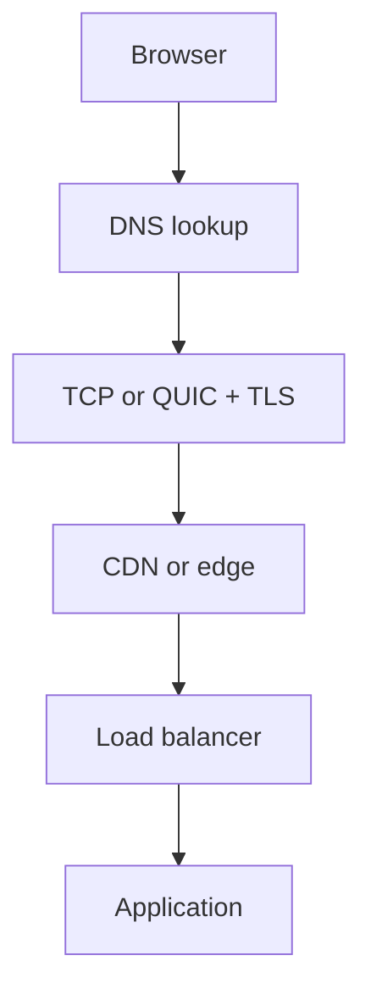

# 14. Computer Networking, Internet & Protocols

> Level: Beginner to advanced | Language: Easy Hinglish

## 1. Networking ka basic idea
Network do ya zyada devices ko connect karta hai taaki data/resources share ho saken. LAN ghar/office jaisi limited jagah ka network hai; WAN large geographic area cover karta hai. Internet networks ka global network hai. Intranet private internal network aur extranet selected external users ke liye controlled access hai.

## 2. Data ka safar
Browser → DNS lookup → TCP connection (ya QUIC) → TLS encryption → HTTP request → load balancer/reverse proxy → application → database/cache → response. Real systems mein CDN, WAF, service mesh aur queues bhi ho sakte hain.

## 3. OSI aur TCP/IP models
OSI ke 7 layers: Physical, Data Link, Network, Transport, Session, Presentation, Application. TCP/IP practical model ko aam taur par Link, Internet, Transport, Application layers mein samjhaya jata hai. Models troubleshooting mein help karte hain; real protocols perfectly textbook boxes mein fit nahi hote.

| Layer/area | Example | Sawal |
|---|---|---|
| Link | Ethernet, Wi-Fi, MAC | Same local network par kaise bheje? |
| Network | IP, routing | Do networks ke beech path? |
| Transport | TCP, UDP, QUIC | Reliable delivery ya low latency? |
| Application | HTTP, DNS, SMTP | App-level meaning kya hai? |

## 4. IP, subnet, gateway, ports
IP address device/interface ko network par address karta hai. IPv4 32-bit aur IPv6 128-bit hai. Subnet CIDR notation (jaise /24) address range define karti hai. Default gateway doosre networks tak traffic forward karta hai. Port process/service ko identify karta hai; IP + port connection endpoint ko identify karne mein help karte hain. Private IP ranges internet par directly globally routable nahi hoti; NAT address translation kar sakta hai.

## 5. DNS
DNS domain name ko IP aur other records se map karta hai. A/AAAA address records, CNAME alias, MX mail routing, TXT verification/policy, NS nameservers aur PTR reverse lookup ke common examples hain. Resolver caching TTL ke hisaab se answer store karta hai. DNS change instant har jagah dikhna guaranteed nahi.

## 6. HTTP, HTTPS, TLS
HTTP request/response protocol hai. Methods mein GET, POST, PUT, PATCH, DELETE aam hain. Status codes: 2xx success, 3xx redirect, 4xx client-side issue, 5xx server-side issue. HTTPS HTTP ko TLS se protect karta hai. TLS server identity certificate se verify karne aur transit encryption mein madad karta hai; HTTPS app ke andar broken authorization ko fix nahi karta.

HTTP/1.1, HTTP/2 aur HTTP/3 transport/multiplexing behavior mein differ karte hain. HTTP/3 QUIC par chalta hai. Cookies, cache headers, compression, content negotiation, CORS aur CSP ko browser-facing systems mein samajhna zaroori hai.

## 7. TCP vs UDP vs QUIC
- TCP: connection-oriented, ordered reliable byte stream; retransmission/flow control.
- UDP: datagrams, lower protocol overhead; delivery/order guarantee nahi.
- QUIC: UDP ke upar secure transport features, stream multiplexing; HTTP/3 mein use hota hai.
Protocol choice latency, reliability aur network behavior par depend karti hai.

## 8. Reverse proxy, load balancer, CDN, firewall
Reverse proxy client ke saamne server-side gateway hota hai. Load balancer traffic instances mein distribute karta hai. CDN users ke kareeb static/cached content serve karta hai. Firewall traffic rules enforce karta hai; WAF web requests ke common attack patterns inspect kar sakta hai. Ye interchangeable tools nahi hain.

## 9. Common troubleshooting commands
- `ping`: reachability/latency hint; ICMP blocked ho sakta hai.
- `traceroute` / `tracert`: route path hints.
- `nslookup` / `dig`: DNS resolution.
- `curl -I https://example.com`: HTTP response headers.
- `ipconfig` / `ip addr`: local interface config.
- `ss` / `netstat`: sockets/listening ports.
Tools ke output ko context ke saath interpret karein.

## 10. Security and reliability
Least exposure, private subnets, security groups, network segmentation, VPN/zero-trust access, TLS, DNSSEC where applicable, DDoS protection, rate limits and egress controls defense-in-depth ka hissa hain. Network diagram mein trust boundaries aur data flows draw karein.

## Practical lab
1. Browser DevTools Network tab mein ek page ki requests dekho.
2. DNS resolve karke returned IP note karo.
3. `curl -I` se headers inspect karo.
4. Diagram banao: user, DNS, CDN, load balancer, app, DB.
5. Ek failure scenario likho: DNS wrong, certificate expired, port blocked, server timeout.

## Revision questions
1. DNS aur HTTP ka role alag kaise hai?
2. TCP aur UDP ka trade-off kya hai?
3. HTTPS hone ke baad bhi app insecure kaise ho sakti hai?
4. CDN aur load balancer ka difference?
5. 404 aur 500 ka practical meaning?

## Visual example (diagram)

**Browser-to-server path** — is simplified flow ko real system ke example ki tarah dekhein.

## Practical deep dive: website request network se kaise guzarti hai?

1. User browser mein domain enter karta hai.
2. DNS domain name ko relevant IP address se resolve karne mein help karta hai.
3. Browser server se network connection establish karta hai; HTTPS mein TLS security negotiation bhi hoti hai.
4. Browser HTTP request bhejta hai.
5. Request CDN, firewall, load balancer ya server tak pahunch sakti hai.
6. Server response deta hai; browser content render karta hai.

Actual path caching, protocol version, proxy, CDN aur hosting architecture ke hisaab se differ kar sakta hai.

### Protocols ka role
- **IP:** packets ko networks ke beech address/routing karne mein help karta hai.
- **TCP:** reliable ordered byte stream provide karta hai.
- **UDP:** datagram transport; delivery/ordering guarantees TCP jaisi nahi.
- **DNS:** names ko records/IP information se resolve karta hai.
- **HTTP:** web request/response semantics.
- **TLS:** communication ko encrypt/authenticate karne ke liye.
- **DHCP:** network par devices ko IP configuration assign karne mein common.
- **VPN:** encrypted/tunneled connectivity provide kar sakta hai; configuration aur trust model matter karte hain.

### Troubleshooting ladder
- Sirf ek website fail hai ya sab?
- Domain resolve ho raha hai?
- Device ki network connectivity theek hai?
- Browser certificate/date error dikha raha hai?
- VPN/proxy/firewall ya DNS settings issue ho sakti hain?
- Server side status page/logs available hain?
- Exact timestamp, error aur safe diagnostic output record karo.

Public systems ko scan ya test karne se pehle authorization aur scope confirm karo.

### Practice lab
Apne khud ke browser se kisi public website ko open karke domain, HTTPS certificate details aur browser developer tools ka Network tab observe karo. Credentials/cookies copy ya share mat karo. Ek simple request flow draw karo aur explain karo ki DNS failure aur server failure mein symptoms kaise differ ho sakte hain.

### Further learning
- [MDN HTTP](https://developer.mozilla.org/en-US/docs/Web/HTTP)
- [Cloudflare Learning Center](https://www.cloudflare.com/learning/)
- [RFC Editor](https://www.rfc-editor.org/)

## Quick answer guide
1. DNS resolves names to records such as IP addresses; it does not itself serve the website content.
2. TCP provides a reliable ordered byte stream; UDP offers datagrams without TCP's delivery/ordering guarantees.
3. HTTPS uses HTTP over a secure transport setup involving TLS.
4. A DNS failure and an application-server failure can look similar to users, so use scoped diagnostics and evidence rather than assuming the cause.

## Review status
- Content milestone: practical beginner expansion.
- Verification status: not yet independently deep-reviewed.
- Last content expansion: 2026-10-30.
- Next review: verify protocol explanations against current RFC/MDN documentation and add a safe troubleshooting walkthrough.

## Safe troubleshooting exercise: “Website not opening”

Use a website you own or are authorized to test.

1. Record exact browser error and time.
2. Check whether other trusted sites work.
3. Verify the domain spelling and certificate/date warnings.
4. Compare results from a permitted second network/device if available.
5. Use standard local diagnostic tools only on your own device/network; record outputs and redact public/private IP details before sharing.
6. Check the service status page or server logs if you own the site.
7. Change one variable at a time and note whether it changes the result.

**Interpretation caution:** DNS, routing, TLS, browser extensions, proxy rules and server errors can create overlapping symptoms. A single failed request does not identify the root cause.

## Lab review checklist
A strong troubleshooting note records the exact symptom/time, scope, tests performed, observed outputs and next hypothesis. Change one variable at a time and use only authorized systems. Avoid concluding “DNS issue” or “server issue” without evidence that distinguishes those possibilities.
