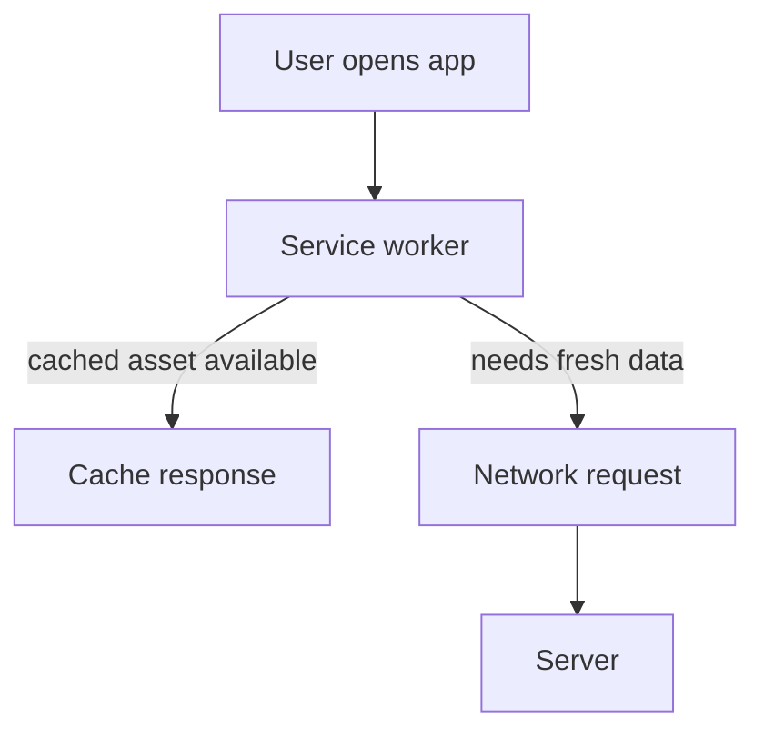

# 15. Mobile Apps, PWA & Frontend Platforms

## 1. Platform options
- Native: Android ke liye Kotlin/Java, iOS ke liye Swift; platform APIs aur performance par strong control.
- Cross-platform: Flutter, React Native jaise tools se shared code, lekin native integration/testing phir bhi chahiye.
- Mobile web: browser mein responsive website.
- PWA: web technologies + installability/offline-capable patterns; support browser/OS ke hisaab se vary karta hai.

## 2. Responsive design
Mobile-first design mein chhoti screen se start karke larger screens par expand karte hain. Fluid grids, flexible images, CSS media queries, readable typography, touch targets, keyboard navigation aur reduced-motion preference consider karein. Sirf viewport shrink karna complete responsive design nahi.

## 3. PWA building blocks
Web app manifest app name, icons, start URL aur display mode batata hai. Service worker network requests ko intercept/cache kar sakta hai aur offline experience enable kar sakta hai. HTTPS required hota hai (localhost development exception). Cache strategy content type ke mutabik choose karein:
- Cache-first: stable assets.
- Network-first: frequently changing data.
- Stale-while-revalidate: fast cached response plus background refresh.
Private/user-specific data ko careless cache karna privacy leak create kar sakta hai.

## 4. Offline-first and sync
Offline UI mein user ko clearly batayein ki action local save hua ya server par confirm hua. Outbox queue, retry with backoff, idempotency key, conflict resolution aur sync status design karein. Offline mode ka matlab har operation safely offline chal sakta hai, aisa nahi.

## 5. App lifecycle and state
Apps foreground/background, interrupted network, permission denial, low storage, app updates aur device rotation jaise conditions handle karein. UI state, persisted state, server state aur cache state ko distinguish karein. Loading, empty, error, offline, permission-denied aur success states design karein.

## 6. Accessibility and performance
Semantic controls, labels, screen-reader support, contrast, focus order, dynamic text sizing and reduced motion test karein. Performance metrics mein startup time, interaction responsiveness, frame drops, bundle size, image weight and network request count shamil hain. Low-end device aur slow network par test karna important hai.

## 7. Mobile security
Secrets app bundle mein hard-code na karein. Secure storage platform APIs use karein, sensitive logs avoid karein, deep links validate karein, TLS use karein, permissions minimum rakhein, device/root detection ko sole defense na banayein, and backend authorization enforce karein. Client-side checks ko trusted security boundary mat samjhein.

## 8. Release process
Development, staging, production environments; signed builds; versioning; app-store review; phased rollout; crash analytics; rollback/disable strategy; compatibility matrix; privacy disclosures. Feature flags gradual exposure mein help karte hain, lekin flags ko clean up karna hota hai.

## Practical project
Ek PWA task tracker banayein: manifest, service worker, offline static shell, network-first task sync, accessible forms, offline banner, retry state, responsive layout. Test karein: airplane mode, expired session, stale cache, failed sync.

## Interview questions
1. PWA vs native app?
2. Service worker aur manifest ka role?
3. Offline edits mein conflicts kaise resolve karenge?
4. Client-side validation security ke liye enough kyun nahi?

## Visual example (diagram)

**PWA request and cache flow** — is simplified flow ko real system ke example ki tarah dekhein.

### Real-world reference image: Service worker lifecycle

Source: [MDN — Using Service Workers](https://developer.mozilla.org/en-US/docs/Web/API/Service_Worker_API/Using_Service_Workers). Image registration, installation, activation aur page control ke phases samajhne mein help karti hai.

## Practical deep dive: responsive website, PWA aur native app

### Options ka comparison
- **Responsive website:** browser mein chalti hai; multiple screen sizes ke liye layout adapt hota hai.
- **Progressive Web App (PWA):** web app mein installability, service worker aur selected offline capabilities add ho sakti hain; platform support differ karta hai.
- **Native app:** platform-specific APIs aur distribution use kar sakti hai; development/maintenance multiple platforms par costly ho sakti hai.
- **Cross-platform app:** shared codebase se multiple platforms target kar sakti hai; native integrations aur performance trade-offs evaluate karne hote hain.

### Service worker aur cache
Service worker network requests ko handle karne aur selected assets/data cache karne mein help kar sakta hai. Caching strategy app ke content aur risk ke mutabiq choose karo:
- Static assets: cache-friendly ho sakte hain.
- Frequently changing data: freshness rules define karo.
- Private account data: shared-device privacy aur logout behaviour carefully design karo.
- New release: cache update aur old/new version compatibility test karo.

Offline UI dikhana is baat ka proof nahi ki har transaction offline safe hai. Payment, inventory aur account actions ke liye server confirmation zaroori ho sakti hai.

### Mobile quality checklist
- Touch target size aur readable text
- Keyboard/screen reader support
- Slow network/loading/error states
- Install prompt optional and respectful
- Permissions sirf feature need hone par
- Offline limitations clearly explained
- App updates aur stale cache handling
- Battery, memory aur data usage consider karo

### Practice lab
Ek small notes ya product-catalog PWA ka plan banao. Decide karo kya offline available hoga, data kab sync hoga, conflicts kaise handle honge aur logout par private cached data ka kya hoga. Browser devtools se online/offline aur slow network behaviour test karo.

### Further learning
- [MDN Progressive Web Apps](https://developer.mozilla.org/en-US/docs/Web/Progressive_web_apps)
- [web.dev Learn PWA](https://web.dev/learn/pwa/)
- [MDN Service Worker API](https://developer.mozilla.org/en-US/docs/Web/API/Service_Worker_API)

## Quick answer guide
1. Responsive websites adapt layouts; PWAs may add install/offline capabilities; native apps use platform-specific capabilities; cross-platform tools share code across targets.
2. A service worker can intercept requests and support caching, but behaviour varies by browser/platform.
3. Offline display does not prove that a payment or account change completed; server confirmation and sync/conflict handling matter.
4. Private cached data needs special care on logout and shared devices.

## Review status
- Content milestone: practical beginner expansion.
- Verification status: not yet independently deep-reviewed.
- Last content expansion: 2026-10-30.
- Next review: check current browser support/limitations and test the linked service-worker lifecycle diagram.
