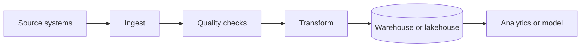

# 16. Data Engineering, Analytics, AI & Machine Learning

## 1. Data lifecycle
Source systems → ingestion → validation → storage → transformation → analytics/model → decision/action → monitoring. Data quality, lineage, access controls and retention har stage par matter karte hain.

## 2. Data categories and storage
- Structured: rows/columns, e.g. orders.
- Semi-structured: JSON/events.
- Unstructured: documents, images, audio.
- OLTP database: operational reads/writes.
- OLAP warehouse: analytical queries across large datasets.
- Data lake: varied raw/processed data; lakehouse approaches combine lake flexibility with table/transaction capabilities.
Choose based on query patterns, consistency, latency, governance and cost—not hype.

## 3. ETL vs ELT
ETL: extract, transform, load. ELT: extract, load into target platform, then transform. Batch handles scheduled groups; streaming processes events continuously or near-real-time. Exactly-once claims depend on system semantics; practical pipelines often use idempotency, deduplication and replay.

## 4. Data modeling
Entities, primary/foreign keys, constraints, normalization, dimensional models, facts/dimensions, slowly changing dimensions and event schemas. Track event time vs processing time, timezone, currency, units and schema versions. Poor definitions produce misleading dashboards.

## 5. Analytics maturity
- Descriptive: kya hua?
- Diagnostic: kyun hua?
- Predictive: kya ho sakta hai?
- Prescriptive: kya action lena chahiye?
Metrics need clear owner, formula, grain, time window and source of truth. Correlation causation ka proof nahi hai; experiments and causal methods help.

## 6. AI vs ML vs deep learning vs generative AI
AI broad field hai; ML data se patterns learn karta hai; deep learning neural networks ka family hai; generative AI new text/image/audio/code produce kar sakta hai. A language model next-token probabilities se text generate karta hai; fluent answer automatically verified fact nahi hota.

## 7. ML lifecycle
Problem definition → representative data → split train/validation/test → baseline → train → evaluate → deployment → monitor drift, quality, fairness, latency and cost. Data leakage evaluation ko unrealistically good bana sakta hai. Production models require versioning, reproducibility and rollback.

## 8. Generative AI applications and risks
Use cases: search assistance, summarization, drafting, classification, support triage, coding help. Risks: hallucination, prompt injection, sensitive-data exposure, copyright/IP uncertainty, biased output, overreliance and variable cost. Human review and constrained tool permissions matter for high-impact actions.

## 9. Retrieval-Augmented Generation (RAG)
RAG flow: documents → chunking → embeddings/index → query retrieval → context assembly → model response with source grounding. Evaluate retrieval relevance and answer faithfulness separately. Secure document-level authorization; retrieval must not expose content the user cannot access.

## 10. Vector search and embeddings
Embedding numeric vector representation hoti hai jo semantic similarity approximate kar sakti hai. Similarity metric, chunk size, overlap, metadata filters, multilingual quality and index refresh affect results. Vector DB traditional database ka universal replacement nahi.

## 11. MLOps and LLMOps
Dataset/model/prompt/version tracking, evaluation sets, offline and online metrics, guardrails, latency/cost monitoring, drift detection, feedback loops, rollback and incident response. Test adversarial prompts and retrieval permissions.

## Practical project
CSV sales data clean karein, schema/quality checks likhein, SQL aggregation se dashboard metrics banayein, phir optional FAQ RAG prototype with citations and permission filtering. Sensitive real data use na karein.

## Questions
1. ETL aur ELT ka difference?
2. Training/test split kyun?
3. RAG hallucination ko completely eliminate karta hai?
4. Data leakage kya hota hai?
5. Model accuracy ke alawa kya monitor karna chahiye?

## Visual example (diagram)

**Data pipeline** — is simplified flow ko real system ke example ki tarah dekhein.

## Practical deep dive: data se decision aur AI tak

### Data pipeline
Common flow: source systems → extract/collect → validate/clean → transform → store → analyze/report → monitor data quality. Har step mein lineage, access controls, failure handling aur ownership define karna useful hai.

### Data quality dimensions
- **Accuracy:** data reality ko sahi represent karta hai?
- **Completeness:** required fields/records missing to nahi?
- **Consistency:** systems ke beech values conflict to nahi karti?
- **Timeliness:** data decision ke liye fresh hai?
- **Uniqueness:** duplicate records to nahi?
- **Validity:** format/business rules satisfy karta hai?

### Analytics vs AI/ML
- **Descriptive analytics:** kya hua?
- **Diagnostic analytics:** kyun hua?
- **Predictive analytics:** likely kya hoga?
- **Prescriptive analytics:** possible next action kya ho sakta hai?
- **Machine learning:** examples/data se patterns learn karne wale models.
- **Generative AI:** text, image, code ya doosra content generate karne wale models.

Model output guaranteed fact nahi. Data leakage, bias, drift, hallucination, privacy aur evaluation risks assess karo.

### AI project lifecycle
Problem and baseline → data permission/quality review → model/approach selection → evaluation → safety/privacy review → limited rollout → monitoring → feedback and rollback plan. Agar simple rules ya search problem solve karte hain, AI use karna zaroori nahi.

### Practice lab
Sample sales CSV ke liye 5 data-quality checks define karo, missing/duplicate records ka treatment decide karo aur 3 metrics ke dashboard ka sketch banao. AI feature propose karte waqt success metric, failure impact, human review aur sensitive-data policy likho.

### Further learning
- [Google Machine Learning Crash Course](https://developers.google.com/machine-learning/crash-course)
- [NIST AI Risk Management Framework](https://www.nist.gov/itl/ai-risk-management-framework)
- [W3C Data on the Web Best Practices](https://www.w3.org/TR/dwbp/)

## Quick answer guide
1. A data pipeline collects, validates, transforms, stores and delivers data for use.
2. Data quality includes accuracy, completeness, consistency, timeliness, uniqueness and validity.
3. Predictive analytics estimates likely outcomes; generative AI creates outputs such as text or images.
4. AI outputs require evaluation and monitoring; a fluent answer is not proof of correctness.

## Review status
- Content milestone: practical beginner expansion.
- Verification status: not yet independently deep-reviewed.
- Last content expansion: 2026-10-30.
- Next review: add a worked data-quality example and check current NIST/Google AI guidance.

## Worked data-quality example: daily sales report

Suppose the source exports one row per order. Before reporting revenue:
1. Check order IDs for duplicates.
2. Validate required order date, currency and status fields.
3. Define whether cancelled/refunded orders are included and how refunds are represented.
4. Normalize time zones before assigning dates.
5. Reconcile record counts and totals with the source system.
6. Mark late-arriving records and rerun the affected reporting window.
7. Record pipeline run time, rejected rows and data freshness.

Never silently discard bad rows without an agreed policy. A report should show freshness/quality warnings when source data is incomplete.
