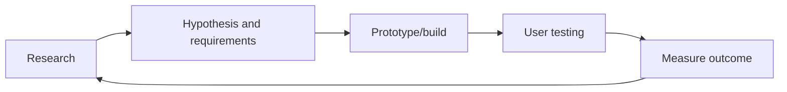

# 17. Product Management, UX, Requirements & Project Delivery

## 1. Problem before solution
Product work user/customer problem, business outcome, constraints and evidence se start hota hai. Feature request ko blindly implement karne se pehle poochhein: kaun user hai, pain kya hai, current workaround kya hai, success kaise measure hoga?

## 2. Discovery artifacts
Personas (research-grounded, stereotypes nahi), journey maps, interviews, surveys, analytics, support-ticket analysis, competitor review, prototype tests and usability observations. Interviews opinions batate hain; observed behavior and quantitative data complementary evidence hain.

## 3. Requirements
- Business requirement: business outcome.
- User requirement: user goal.
- Functional: system kya kare.
- Non-functional: quality attributes such as security, availability, latency, accessibility, scalability.
- Constraint: legal, budget, platform, deadline.
- Acceptance criteria: completion verify karne ke testable conditions.
Ambiguous words—fast, secure, user-friendly—ko measurable conditions mein badlein.

## 4. User stories and use cases
Example: “As a customer, I want to reset my password so that I can regain account access.” Acceptance criteria include valid token, expiry, rate limiting, generic response that avoids account enumeration, and audit/security notifications where appropriate. User story alone detailed specification ka replacement nahi.

## 5. Prioritization
MoSCoW (Must/Should/Could/Won't now), RICE (Reach, Impact, Confidence, Effort) and cost-of-delay are tools, not objective truth. Dependencies, risk, strategic fit and accessibility/security obligations ko scorecard mein include karein.

## 6. UX and interaction design
Information architecture, navigation, hierarchy, typography, color/contrast, forms, feedback, errors, loading, empty states, responsive behavior and accessibility. Prototype low-fidelity se start ho sakta hai; usability testing se assumptions validate karein. Design system components consistent behavior and tokens define karte hain.

## 7. Delivery methods
Waterfall sequential planning; Agile values iterative feedback; Scrum defines roles/events/artifacts; Kanban visualizes flow and limits work in progress. Hybrid approaches common hain. Ceremony ka purpose coordination and learning hai, meetings ki quantity nahi.

## 8. Planning and estimation
Break work into deliverables, identify dependencies/risks, estimate ranges rather than false precision, define milestones, and reserve capacity for support/unknowns. Story points are team-relative planning aid, employee productivity score nahi.

## 9. Risk management
Risk register: risk, probability, impact, owner, mitigation, trigger and contingency. Separate known issue from uncertain risk. Security, privacy, migration, vendor lock-in, performance and adoption risks early assess karein.

## 10. Metrics and experiments
North-star metric, input metrics, guardrails, funnel conversion, retention, task success, time-on-task, error rate and support burden. A/B tests need hypothesis, randomization, sample size, duration and guardrails; avoid peeking-driven false conclusions and privacy violations.

## 11. Release and feedback loop
Feature flags, staged rollout, release notes, support readiness, analytics, rollback, user feedback and post-release review. A successful deploy is not automatically a successful product outcome.

## Practical exercise
Employee leave portal ke liye problem statement, 3 user stories, acceptance criteria, 5 non-functional requirements, basic journey map, risk register and release checklist likhein.

## Questions
1. Functional vs non-functional requirement?
2. Acceptance criteria testable kyun hone chahiye?
3. RICE ke limitations?
4. Agile ka matlab no planning hai?

## Visual example (diagram)

**Product feedback loop** — is simplified flow ko real system ke example ki tarah dekhein.

## Practical deep dive: product idea ko testable scope mein badalna

### Discovery se pehle
- User aur unka context identify karo.
- Problem ko solution se alag likho.
- Interviews/observations se evidence collect karo.
- Assumptions ko label karo; unhe confirmed facts mat samjho.
- Existing workaround aur competing solutions samjho.
- Success metric aur unacceptable outcomes define karo.

### Prioritization
MoSCoW (Must/Should/Could/Won't for now) ya impact-vs-effort matrix jaise simple methods use kar sakte ho. Score ek decision aid hai, objective truth nahi. Security, accessibility, legal obligations aur reliability ko sirf low-feature-priority kehkar ignore nahi karna chahiye.

### UX flow aur states
Har important flow mein initial state, loading, success, empty, validation error, network error, permission denied aur recovery/next step socho. UI sirf ideal happy path par design na karo.

### Project risks
Risk register mein risk, likelihood, impact, owner, mitigation, trigger aur contingency likho. Dependencies, assumptions, decision log aur change requests ko visible rakho. Scope change ka timeline, cost, quality aur risk par impact assess karo.

### Practice lab
Ek employee leave-request feature ke liye persona/context, problem statement, 5 user stories, acceptance criteria, user flow, 5 risks, priority rationale aur success metrics likho. 2 users se prototype feedback lene ka plan bhi banao.

### Further learning
- [Nielsen Norman Group](https://www.nngroup.com/articles/)
- [Atlassian Agile Coach](https://www.atlassian.com/agile)
- [W3C Accessibility](https://www.w3.org/WAI/)

## Quick answer guide
1. A problem statement describes the user need; a proposed solution is one possible response to that need.
2. Prioritization methods support decisions but do not replace judgment, user evidence or mandatory safety/compliance work.
3. Loading, empty, error and permission-denied states are part of a complete UX flow.
4. A risk register should include an owner, likelihood/impact, mitigation and a trigger/contingency.

## Review status
- Content milestone: practical beginner expansion.
- Verification status: not yet independently deep-reviewed.
- Last content expansion: 2026-10-30.
- Next review: add an example discovery brief and complete acceptance-criteria walkthrough.
