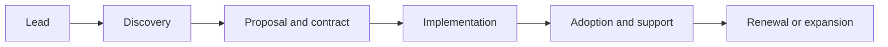

# 18. IT Business, Finance, Sales, Procurement & Legal Basics

## 1. IT company ka business model
Revenue product subscriptions, licenses, implementation projects, consulting hours, managed services, usage-based billing, support contracts or marketplace commissions se aa sakta hai. Revenue profit nahi hota: profit = revenue minus costs/expenses (accounting treatment ke hisaab se). Cash flow and booked revenue bhi different concepts hain.

## 2. Common commercial models
- Fixed price: defined scope, vendor delivery risk higher; scope changes need change control.
- Time and materials: actual effort/rates; flexible but budget governance needed.
- Retainer: reserved ongoing capacity/services.
- Subscription: recurring access, renewal/churn important.
- Usage-based: consumption-based pricing; metering and cost predictability important.
- Outcome-based: agreed outcomes; measurement and attribution complex.
Contracts should define scope, assumptions, acceptance, payment, change process, support and termination.

## 3. Sales and customer lifecycle
Lead → qualification → discovery → proposal/estimate → security/procurement review → contract → onboarding → delivery/adoption → renewal/expansion. CRM records pipeline and relationships. Avoid promising unvalidated delivery dates or capabilities.

## 4. Procurement and vendor management
Evaluate capability, total cost of ownership, security posture, privacy terms, data location, uptime, support, exit plan, subcontractors, portability and financial stability. Vendor risk continues after purchase: monitor renewals, incidents, changes and access.

## 5. Unit economics and finance
Gross margin, operating margin, customer acquisition cost (CAC), lifetime value (LTV), churn, retention, payback period, utilization and recurring revenue are common metrics. Definitions differ across organizations; document formula, period and cohort. High utilization can harm learning and sustainability if treated as the only goal.

## 6. Estimation and scope control
Estimate effort, uncertainty, dependencies, integration, testing, deployment, documentation and support—not just coding. Maintain assumptions, contingency and change log. Scope change should record impact on schedule, cost, risk and acceptance.

## 7. Contracts and intellectual property
Common concepts: statement of work (SOW), master services agreement (MSA), service-level agreement (SLA), data processing agreement (DPA), confidentiality/NDA, licensing, warranties, indemnity, liability limits and termination. Exact legal effect depends on jurisdiction and wording; use qualified legal counsel for binding advice.

## 8. Open-source and software licensing
Permissive licenses (e.g. MIT, Apache-2.0) and copyleft licenses (e.g. GPL family) have different conditions. Keep dependency/license inventory, preserve required notices, assess distribution and SaaS obligations, and review patents/security. “Public on GitHub” does not automatically mean unrestricted public-domain software.

## 9. Privacy and data protection
Identify personal data, purposes, lawful basis where applicable, retention, access, processors, cross-border transfers, data-subject rights and breach obligations. Collect minimum data. Regulatory duties depend on user location, company role, data category and current law; verify current legal sources.

## 10. Procurement checklist
1. Business need and alternatives.
2. Security/privacy assessment.
3. Contract, scope and acceptance.
4. Total cost and renewal terms.
5. Integration and migration plan.
6. Exit/export/deletion plan.
7. Owner and periodic review.

## Practical exercise
Compare two SaaS vendors for an office task tool using a scorecard: capability, security, accessibility, integration, support, price, portability and exit cost.

## Questions
1. Revenue vs profit vs cash flow?
2. Fixed-price vs time-and-materials?
3. Why is vendor exit planning important?
4. Does open-source mean no license obligations?

## Visual example (diagram)

**Customer lifecycle** — is simplified flow ko real system ke example ki tarah dekhein.

## Practical deep dive: commercial, legal aur procurement basics

### Customer deal lifecycle
Lead → discovery → proposal/statement of work → commercial/legal review → agreement → delivery → acceptance → invoice/payment → support/renewal. Real organizations mein stages aur approval controls differ karte hain.

### Contract documents ka role
- **Proposal:** recommended solution, approach aur estimated cost.
- **SOW (Statement of Work):** scope, deliverables, assumptions, responsibilities, timeline aur acceptance process.
- **SLA:** agreed service levels, measurement aur remedies/limitations where applicable.
- **DPA:** personal data processing responsibilities define kar sakta hai.
- **Change request:** approved scope/budget/timeline changes record karta hai.

Ye educational overview hai, legal advice nahi. Contract aur privacy requirements jurisdiction aur business context ke hisaab se qualified professional se review karayein.

### Procurement checklist
Requirements, vendor due diligence, security/privacy review, pricing model, support hours, uptime commitments, data location/retention, accessibility, integration, exit/export plan, renewal terms aur hidden costs compare karo.

### Cost concepts
- One-time implementation vs recurring license/support
- Internal staff time and training
- Migration/integration costs
- Usage, storage, data transfer and support tiers
- Exit cost and vendor lock-in risk

Lowest initial price hamesha lowest total cost nahi hoti.

### Practice lab
Ek small company ke liye project SOW outline banao: goals, in-scope/out-of-scope, deliverables, acceptance criteria, assumptions, roles, timeline, payment milestones, support, data handling aur change-control process.

### Further learning
- [NIST Cybersecurity Framework](https://www.nist.gov/cyberframework)
- [U.S. Federal Acquisition Regulation (reference example)](https://www.acquisition.gov/browse/index/far) — procurement rules vary by jurisdiction.
