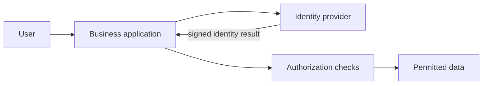

# 19. Enterprise Integration, Identity, Governance & Compliance

## 1. Enterprise reality
Large organizations have many apps, teams, data owners, legacy systems and regulatory obligations. The hard problem is often process, ownership and integration—not merely coding. Map systems, data flows, trust boundaries and business owners before selecting architecture.

## 2. Identity and access
Authentication verifies who/what is requesting access; authorization determines permitted actions. Identity provider (IdP), service provider (SP), directory, MFA, SSO, RBAC, ABAC, SCIM provisioning and privileged access management are common concepts. Disable leavers promptly, review permissions periodically and use least privilege.

## 3. SAML, OAuth 2.0 and OpenID Connect
SAML is commonly used for enterprise browser SSO assertions. OAuth 2.0 is an authorization framework for delegated access. OpenID Connect adds an identity layer on OAuth 2.0. They are not interchangeable. Validate issuer, audience, signature, expiry, redirect URI and state/nonce as applicable; follow current security best practices.

## 4. Integration patterns
- Synchronous API call: immediate response, runtime coupling.
- Asynchronous messaging: producers and consumers decoupled, but eventual consistency/retries required.
- Batch file exchange: simple but latency and reconciliation matter.
- Webhooks: event notifications to a receiver; signatures, retries and idempotency are important.
- iPaaS/ESB: integration tooling/platform; governance and complexity still remain.

## 5. Event-driven systems
Events represent facts that happened. Consumers may process at least once, so idempotency and deduplication matter. Use schema evolution/versioning, dead-letter handling, replay controls, ordering strategy and observability. Avoid treating a command (“please charge”) and event (“charge completed”) as the same thing.

## 6. Master data and governance
Master data includes shared entities such as customer, product, employee and supplier. Data governance defines owners, stewards, quality rules, classification, lineage, retention and access. Golden record decisions need matching rules and human correction processes.

## 7. Multi-tenant and enterprise controls
Tenant isolation must apply to queries, caches, files, background jobs, logs and analytics—not only the UI. Consider tenant ID propagation, row-level security, encryption key strategy, per-tenant quotas, audit logs and backup/restore scope. Test cross-tenant access explicitly.

## 8. Auditability and compliance
Audit records should capture actor, action, target, timestamp, outcome and relevant context while avoiding secrets and unnecessary personal data. Protect logs from tampering and restrict access. Control frameworks can help organize evidence, but compliance certification does not guarantee every system is secure.

## 9. Legacy modernization
Options include rehost, replatform, refactor, replace, retire and retain. Assess business criticality, undocumented dependencies, data quality, migration window, rollback and coexistence. Strangler pattern gradually routes capabilities to a replacement; dual-write needs careful consistency design.

## 10. Governance without bottlenecks
Define architecture principles, security review triggers, data ownership, exception process, decision records and service ownership. Lightweight standards and reusable paved roads are often more effective than a slow approval board for every change.

## Practical project
Draw integration map for HRMS, payroll, identity provider, leave portal and analytics warehouse. Mark systems of record, PII flows, API/event/batch links, owner, failure handling and retention.

## Questions
1. Authentication vs authorization?
2. OAuth 2.0 vs OpenID Connect?
3. Why should event consumers be idempotent?
4. What does tenant isolation mean beyond UI filtering?

## Visual example (diagram)

**SSO authentication path** — is simplified flow ko real system ke example ki tarah dekhein.

## Practical deep dive: enterprise integration aur identity

### Integration patterns
- **Synchronous API:** caller response ka wait karta hai; interactive queries ke liye useful.
- **Asynchronous messaging:** sender message queue/topic par publish karta hai; consumers baad mein process kar sakte hain.
- **Batch transfer:** data scheduled intervals par move hota hai.
- **Event-driven integration:** business event par downstream systems react karte hain.
- **iPaaS/ESB:** integration platform ya service bus multiple systems ke connections manage karne mein help kar sakta hai.

Patterns ko latency, reliability, ordering, replay, cost aur operational complexity ke basis par choose karo.

### Identity terms
- **Authentication:** identity verify karna.
- **Authorization:** allowed actions decide karna.
- **SSO:** one identity session se multiple connected apps access karna, policy ke mutabiq.
- **MFA:** authentication ke liye multiple factor categories use karna.
- **SAML / OpenID Connect:** identity federation ke common protocols; exact use case ke hisaab se select karo.
- **SCIM:** identity lifecycle/provisioning automate karne ke liye standard.
- **RBAC:** roles ke basis par permissions.
- **ABAC:** attributes/context ke basis par access decisions.

SSO ka matlab har app mein unlimited permission nahi. App-level authorization aur timely access removal phir bhi zaroori hain.

### Governance basics
Data owner, system owner, retention rules, access review, audit logs, approval authority aur exception process define karo. Employee transfer/exit par access update/remove karne ka tested workflow rakho.

### Practice lab
HR system se employee joiner/mover/leaver events ke through email aur project tools access manage karne ka flow draw karo. Duplicate events, delayed messages, failed provisioning aur employee exit ke risks aur reconciliation checks likho.

### Further learning
- [OpenID Foundation](https://openid.net/)
- [OASIS SAML Technical Committee](https://www.oasis-open.org/committees/tc_home.php?wg_abbrev=security)
- [RFC Editor](https://www.rfc-editor.org/)

## Quick answer guide
1. Synchronous APIs wait for a response; asynchronous messaging lets work be processed later.
2. SSO simplifies sign-in but does not automatically grant broad authorization in each app.
3. RBAC uses roles; ABAC can use attributes and context in access decisions.
4. Joiner/mover/leaver workflows must handle delayed or duplicate events and verify that departed users lose access promptly.

## Review status
- Content milestone: practical beginner expansion.
- Verification status: not yet independently deep-reviewed.
- Last content expansion: 2026-10-30.
- Next review: verify identity protocol descriptions against current official specifications and add an end-to-end provisioning example.

## Worked joiner/mover/leaver workflow

**Joiner:** HR approves the employee record → identity account is created → role-based access is provisioned → owner verifies required apps.  
**Mover:** manager/department changes → access is recalculated → obsolete permissions are removed → audit event recorded.  
**Leaver:** termination event is authorized → access is disabled/revoked according to policy → sessions/tokens are handled → assets/data ownership transferred → retention and audit requirements followed.

Failure cases include duplicate events, delayed HR updates, unavailable downstream apps and partial provisioning. Use idempotent processing, reconciliation reports, clear ownership and alerts for incomplete access changes. High-risk access removal may require a faster controlled path than ordinary batch provisioning.

## Lab review checklist
A strong identity/integration design states event ownership, authentication, authorization, retries, duplicate handling, audit trail and failure reconciliation. Test delayed, duplicated and failed provisioning events, especially employee exit and removal of privileged access. Do not assume SSO alone solves application authorization.
