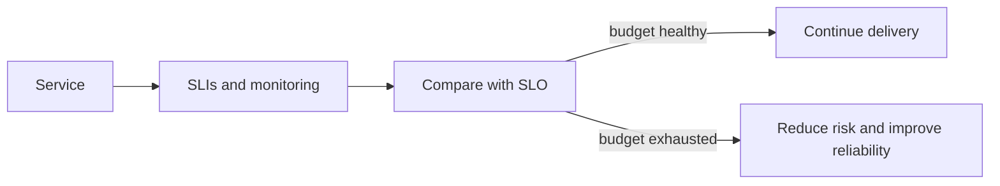

# 20. Quality Attributes, Architecture Decisions & Engineering Trade-offs

## 1. Functional behavior vs quality attributes
Functional requirement says what system does. Quality attributes describe how well it does it: availability, latency, throughput, scalability, security, privacy, accessibility, usability, maintainability, portability, interoperability, observability, recoverability and cost efficiency.

## 2. Turn vague goals into measurable scenarios
Instead of “system fast,” define: “Under 2,000 concurrent users and 200 requests/second, 95th percentile read latency remains below agreed threshold for specified endpoint.” Specify workload, environment, measurement window and acceptable failure behavior. Numbers must come from product needs and testing, not arbitrary templates.

## 3. Availability and reliability math
Availability approximation: uptime / total measured time. For independent serial components, end-to-end availability can be lower than each component; redundancy helps only if failure modes are sufficiently independent. SLA is a contractual promise, SLO an internal/service objective, and SLI the measured indicator. Error budget is the allowed unreliability implied by an SLO.

## 4. Latency percentiles and throughput
Average latency can hide tail delays. p50 is median, p95 means 95% of measured requests are at or below that latency, and p99 highlights tail experience. Throughput is completed work per time. Test realistic traffic mix, cache warmth, data size and failure conditions.

## 5. Scalability and capacity
Vertical scaling increases resources on a node; horizontal scaling adds nodes. Stateless services are easier to scale horizontally, while stateful components need replication/partitioning/consistency strategy. Capacity planning includes CPU, memory, connection pools, DB IOPS, network, queue depth and downstream limits.

## 6. Resilience patterns
Timeouts prevent indefinite waits; retries should be bounded and use backoff/jitter; circuit breakers reduce repeated calls to failing dependencies; bulkheads isolate resource pools; queues absorb bursts; load shedding protects core service. Retries can amplify overload if poorly designed. Every pattern needs observability and fallback behavior.

## 7. Architecture decisions
Use Architecture Decision Records (ADR): context, decision, alternatives, consequences, date and owner. Prefer reversible decisions under uncertainty. Evaluate build vs buy, monolith vs services, relational vs NoSQL, synchronous vs asynchronous and managed vs self-hosted against actual constraints.

## 8. Threat modeling and privacy by design
Map assets, actors, trust boundaries, entry points and data flows. Ask what can go wrong, likelihood/impact, mitigations and residual risk. Privacy by design means data minimization, purpose limitation, retention controls and user rights considered early, not added only at launch.

## 9. Accessibility as quality
Follow WCAG guidance appropriate to the product; use semantic HTML, keyboard support, visible focus, sufficient contrast, labels, captions and screen-reader testing. Automated checks catch some but not all accessibility defects; include manual testing with assistive technologies and users where possible.

## 10. Maintainability and technical debt
Technical debt is the future cost created by expedient choices, not automatically bad code. Record debt, risk and payoff; reserve capacity to address high-impact items. Modular boundaries, tests, documentation, dependency updates and small changes reduce maintenance cost.

## 11. Cost-aware architecture
Estimate compute, storage, network egress, managed services, licenses, observability, backups, support and engineer time. Optimize the largest measured cost drivers. Premature optimization and distributed systems can increase complexity beyond their benefits.

## Practical exercise
Write 5 measurable quality scenarios for an exchange-like application: market-data freshness, login security, order submission response, failure recovery and accessibility. Add an ADR for choosing synchronous API vs event queue.

## Questions
1. SLI/SLO/SLA difference?
2. Why p95 can be more useful than average?
3. How can retries worsen an outage?
4. What belongs in an ADR?

## Visual example (diagram)

**Reliability feedback loop** — is simplified flow ko real system ke example ki tarah dekhein.

## Practical deep dive: quality attributes aur architecture decisions

### Quality attributes ko measurable banao
- **Availability:** agreed period mein service kitni accessible thi.
- **Latency:** request ko response milne mein kitna time laga; p50/p95/p99 jaise percentiles tail experience dikhate hain.
- **Scalability:** demand badhne par system kaise handle karta hai.
- **Maintainability:** changes ko safely samajhna aur implement karna kitna easy hai.
- **Accessibility:** disabled users samet diverse users system use kar sakein.
- **Security/privacy:** data aur actions risks ke against kaise protected hain.
- **Recoverability:** failure ke baad service/data kitni jaldi restore ho sakte hain.

“Fast”, “secure” aur “reliable” vague words hain jab tak conditions aur measurement define na hon.

### Architecture Decision Record (ADR)
Short ADR mein:
1. Context/problem
2. Decision drivers
3. Options considered
4. Chosen option
5. Consequences and trade-offs
6. Review date/trigger

Decision ko future team ke liye understandable banao; sirf “because best practice” reason kaafi nahi.

### Accessibility review basics
Keyboard-only operation, visible focus, meaningful labels, heading structure, contrast, error identification, zoom/reflow aur screen-reader semantics check karo. Automated tools helpful hain lekin human testing aur assistive technology checks ka replacement nahi.

### Practice lab
Ek dashboard ke liye 4 measurable quality requirements likho. Do architecture options compare karo, ADR banao aur keyboard/accessibility test checklist attach karo.

### Further learning
- [W3C WCAG](https://www.w3.org/WAI/standards-guidelines/wcag/)
- [Google SRE Book](https://sre.google/sre-book/table-of-contents/)
- [Architecture Decision Records](https://adr.github.io/)

## Quick answer guide
1. Quality requirements need measurable conditions, such as a latency percentile under a defined load.
2. An ADR records context, options, the chosen decision and consequences.
3. Automated accessibility scans find some issues but cannot guarantee a usable experience for every disabled user.
4. Availability and recoverability are different: a service may be available now but still have weak disaster recovery.

## Review status
- Content milestone: practical beginner expansion.
- Verification status: not yet independently deep-reviewed.
- Last content expansion: 2026-10-30.
- Next review: add a sample ADR and measurable non-functional requirement set, then verify WCAG references.

## Worked measurable quality requirements

Weak statement: “The app must be reliable and fast.”

More testable examples:
- Under a defined load profile of 200 requests/second in the agreed test environment, 95% of catalogue requests complete within 500 ms, excluding explicitly documented external dependencies.
- For the defined 30-day measurement window, the service meets its agreed availability SLO using a documented request-based or time-based formula.
- Keyboard users can reach and operate every core form control, and focus remains visibly identifiable.
- Backup restoration is demonstrated in a test environment within the agreed recovery-time objective, with restored data meeting the recovery-point objective.

These are sample targets, not universal recommendations. Teams must validate targets against user needs, cost, risk and architecture.
