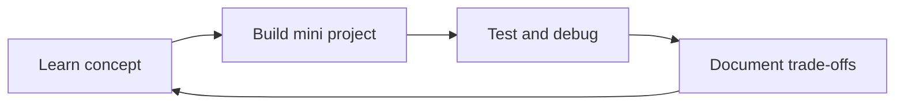

# 21. Career Roadmap, Hands-on Labs, Glossary & Self-Assessment

## 1. Role map
- Frontend: browser UI, accessibility, performance.
- Backend: business logic, APIs, persistence, security.
- Full-stack: both areas with depth appropriate to team.
- Mobile: native/cross-platform apps.
- QA/SDET: test strategy, automation, quality systems.
- DevOps/platform/SRE: delivery pipelines, infrastructure, reliability.
- Data engineer/analyst/scientist: pipelines, metrics, modeling.
- Security engineer: threat modeling, controls, incident response.
- Product/design/business analyst: user problems, requirements, workflows.
- IT support/operations: service restoration, endpoint/network support.
Roles overlap; job titles vary by company.

## 2. Common foundation
Learn command line, Git, networking/HTTP, one programming language deeply, data structures basics, SQL, testing, debugging, security fundamentals, documentation and collaboration. Build projects that demonstrate trade-offs and reasoning—not only tutorial copying.

## 3. Suggested 24-week roadmap
1–2: computer/software fundamentals, command line, Git.
3–5: programming fundamentals, functions, objects, errors, tests.
6–8: HTML/CSS/JavaScript and accessibility.
9–10: HTTP, APIs, auth basics, SQL.
11–12: build a CRUD application with validation and tests.
13–14: deployment, environment variables, logs, monitoring.
15–16: security review, backup/restore, rate limiting.
17–18: caching, queues, performance profiling.
19–20: architecture diagram, ADR, threat model.
21–22: CI pipeline, staged release, rollback.
23–24: polish README, demo, case study and interview practice.
Adjust pace to prior knowledge and available hours.

## 4. Portfolio project ladder
1. Static accessible profile site.
2. API-driven search interface with loading/error/empty states.
3. CRUD task app with SQL and authentication.
4. Multi-tenant team dashboard with authorization tests.
5. PWA with offline shell and safe sync behavior.
6. Observability lab with metrics, logs and incident report.
7. Capstone: design, threat model, test plan, CI/CD, deployment, cost estimate and runbook.

Never publish secrets, real customer data, API keys or personal information in a public repository.

## 5. Practice checklist
For every project, include:
- Problem and intended users.
- Requirements and acceptance criteria.
- Architecture diagram and ADR.
- Setup instructions and environment config.
- Tests and test data.
- Security/privacy notes.
- Accessibility and performance checks.
- Deployment/rollback instructions.
- Known limitations and future improvements.

## 6. Glossary
API: contract for software interaction.  
Artifact: produced build/package/document.  
Authentication: verifying identity.  
Authorization: checking permission.  
Availability: proportion of time a service is usable under defined measurement.  
Cache: temporary copy to reduce repeated work.  
CI/CD: automated integration, validation and delivery/deployment pipeline.  
CDN: geographically distributed content delivery network.  
Container: packaged process environment using OS-level isolation.  
DNS: system mapping names to records such as IP addresses.  
Idempotency: repeating an operation has the same intended effect as doing it once.  
Latency: time taken for an operation.  
Load balancer: distributes requests across targets.  
Observability: inferring internal state from logs, metrics, traces and related signals.  
PWA: web app using capabilities such as manifest and service worker.  
RAG: retrieval-augmented generation.  
RTO: target time to restore service after disruption.  
RPO: acceptable data-loss window measured in time.  
SLA/SLO/SLI: contractual service promise / objective / indicator.  
Tenant: logically separated customer/account within a shared system.  
Throughput: amount of completed work per unit time.  
TLS: protocol for securing transport connections.  
Zero trust: security approach that avoids implicit trust based solely on network location.

## 7. Self-assessment
Score each domain 0–3: 0 = unfamiliar, 1 = can explain, 2 = can build/test, 3 = can diagnose trade-offs. Domains: programming, web, databases, networking, security, testing, cloud, delivery, architecture, product, data, operations. Repeat after each project.

## 8. How to verify information
Prefer current official standards, vendor documentation and reputable primary sources. Note publication/update date. Distinguish established standard from vendor-specific behavior and opinion. Recheck versions before production use.

## Visual example (diagram)

**Learning cycle** — is simplified flow ko real system ke example ki tarah dekhein.

## Practical deep dive: learning ko measurable progress mein badlo

### Skill development loop
Learn concept → explain it in your own words → build a small artifact → test failure cases → get feedback → document lessons → repeat with a harder problem. Sirf videos dekhna practical competence ka proof nahi.

### Portfolio evidence
Har project ke saath problem statement, setup steps, screenshots, architecture diagram, tests, known limitations, security/privacy notes aur future improvements include karo. Secrets aur real user data publish mat karo. External assets ke license/attribution terms verify karo.

### Self-assessment levels
- **Level 1 — Recognize:** term ka meaning pehchanta hoon.
- **Level 2 — Explain:** apni language mein example de sakta hoon.
- **Level 3 — Apply:** guided task complete kar sakta hoon.
- **Level 4 — Diagnose:** failure identify aur fix kar sakta hoon.
- **Level 5 — Evaluate:** alternatives, risks aur trade-offs compare kar sakta hoon.

Ye personal learning rubric hai, industry certification nahi.

### Weekly learning template
1. Goal: is week kya demonstrate karna hai?
2. Concepts: kaun se topics study karne hain?
3. Artifact: code, diagram, report ya test plan kya produce hoga?
4. Verification: output kaise test hoga?
5. Reflection: kya unclear raha aur next step kya hai?

### Practice lab
Apni target role ke liye ek 4-week plan banao. Har week ka measurable deliverable, official learning resource, practice task aur review criteria define karo.

### Further learning
- [GitHub Skills](https://skills.github.com/)
- [freeCodeCamp](https://www.freecodecamp.org/learn/)
- [MDN Learn Web Development](https://developer.mozilla.org/en-US/docs/Learn_web_development)

## Quick answer guide
1. Competence improves when study is followed by explanation, practice, testing, feedback and reflection.
2. A project portfolio should show reproducible setup, decisions, tests and limitations—not only a screenshot.
3. Level 3 in this chapter's rubric means applying a concept in a guided task; the rubric is not a formal industry certification.
4. A learning plan is stronger when each week has a measurable deliverable.

## Review status
- Content milestone: practical beginner expansion.
- Verification status: not yet independently deep-reviewed.
- Last content expansion: 2026-10-30.
- Next review: check glossary coverage against every chapter and add answer keys to all included labs.
