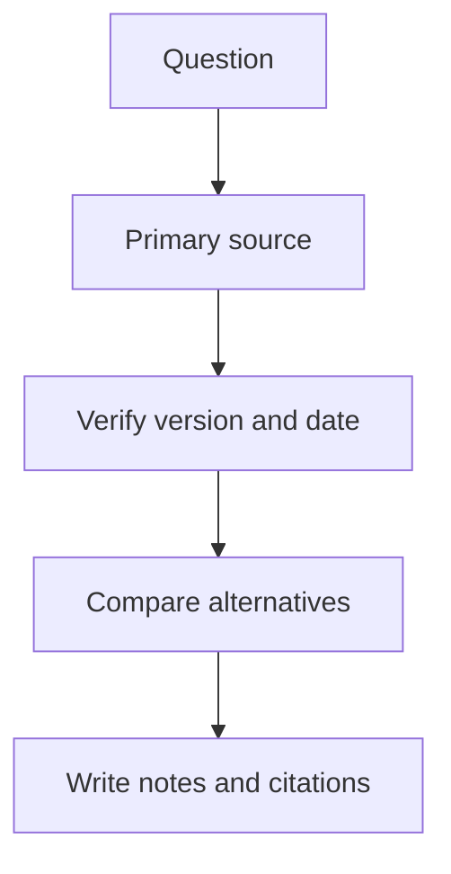

# Research Methodology & Primary Source Index

## How to research a technical topic deeply
For each topic, answer: (1) definition and purpose, (2) problem it solves, (3) how it works, (4) architecture/data flow, (5) alternatives, (6) strengths and limitations, (7) security/privacy risks, (8) reliability and scaling, (9) cost and operations, (10) practical example, (11) failure modes, (12) interview/revision questions.

## Source quality hierarchy
1. Standards and official specifications for protocol/behavior.
2. Official product documentation for product-specific implementation.
3. Reputable books, peer-reviewed research and well-maintained engineering publications.
4. Community discussion for real-world experience, cross-check before treating as fact.
5. Marketing claims and unsourced social posts: leads to investigate, not final proof.

## Primary sources worth bookmarking
- MDN Web Docs: https://developer.mozilla.org/ — web platform, HTML, CSS, JavaScript, HTTP, accessibility.
- WHATWG HTML Standard: https://html.spec.whatwg.org/
- W3C: https://www.w3.org/ — web standards and accessibility guidance.
- IETF RFC index: https://www.rfc-editor.org/ — internet protocol standards.
- OWASP: https://owasp.org/ — application security projects and guidance.
- NIST: https://www.nist.gov/cybersecurity — cybersecurity frameworks and publications.
- CISA: https://www.cisa.gov/ — practical security guidance and alerts.
- Git documentation: https://git-scm.com/doc
- Linux man-pages: https://man7.org/linux/man-pages/
- Kubernetes docs: https://kubernetes.io/docs/
- Docker docs: https://docs.docker.com/
- AWS documentation: https://docs.aws.amazon.com/
- Microsoft Learn: https://learn.microsoft.com/
- Google Cloud documentation: https://cloud.google.com/docs
- PostgreSQL documentation: https://www.postgresql.org/docs/
- MySQL documentation: https://dev.mysql.com/doc/
- MongoDB documentation: https://www.mongodb.com/docs/
- Python documentation: https://docs.python.org/3/
- Java documentation: https://docs.oracle.com/en/java/
- TypeScript handbook: https://www.typescriptlang.org/docs/
- React documentation: https://react.dev/learn
- Node.js documentation: https://nodejs.org/docs/latest/api/
- OpenAPI specification: https://spec.openapis.org/oas/latest.html
- GraphQL specification: https://spec.graphql.org/
- Unicode: https://www.unicode.org/
- WCAG overview: https://www.w3.org/WAI/standards-guidelines/wcag/
- Google SRE books: https://sre.google/books/
- CNCF: https://www.cncf.io/ — cloud-native ecosystem.
- FinOps Foundation: https://www.finops.org/framework/
- Scrum Guide: https://scrumguides.org/
- Agile Manifesto: https://agilemanifesto.org/
- GitHub Docs: https://docs.github.com/
- Python Packaging User Guide: https://packaging.python.org/

## Keep the notes accurate
- Write the date checked when facts are version-sensitive.
- Label provider-specific features as provider-specific.
- Avoid copying long passages; explain concepts in original words and cite sources.
- For laws, finance, health, security and regulated industries, verify current official requirements and get qualified professional review where appropriate.
- Mark uncertain claims and test assumptions.

## Visual example (diagram)

**Research validation** — is simplified flow ko real system ke example ki tarah dekhein.

## Practical deep dive: technical research ko reliable kaise banayein?

### Source hierarchy
- Official standards/specification: protocol ya standard ka authoritative text.
- Official vendor documentation: vendor ke product behaviour aur supported configuration.
- Peer-reviewed research/recognized technical publication: methods and evidence, context ke saath.
- Community posts/blogs: practical clues; version, author expertise aur independent verification check karo.
- Search snippets/social posts: discovery ke liye useful, final proof ke liye usually insufficient.

Official documentation bhi outdated ya product-specific ho sakti hai. Date, version, scope aur assumptions note karo.

### Research workflow
1. Question ko narrow karo: exactly kya verify karna hai?
2. Search terms aur inclusion criteria likho.
3. Primary sources se claim check karo.
4. Competing options aur limitations bhi padho.
5. Tested version/environment record karo.
6. Findings, evidence, uncertainty aur recommendation separate likho.
7. Review date set karo agar facts change ho sakte hain.

### Claim-evidence table
| Claim | Evidence needed | Confidence | Open question |
|---|---|---|---|
| Feature is supported | Current official docs/test | High if directly verified | Plan/region differences? |
| Tool is free | Current pricing/terms | Medium until terms reviewed | Usage limits? |
| System is secure | Threat model + tests + evidence | Never assume from marketing alone | Which risks remain? |

### Practice lab
Ek technology choice par 3 official/primary sources compare karo. Publication/update date, product/version, key finding, limitations aur decision impact record karo. Unsupported marketing claims ko clearly mark karo.

### Further learning
- [NIST Computer Security Resource Center](https://csrc.nist.gov/)
- [RFC Editor](https://www.rfc-editor.org/)
- [W3C Standards](https://www.w3.org/standards/)

## Quick answer guide
1. Primary sources include standards, specifications and official documentation for the exact product/version in question.
2. Official documentation may still be version-specific or outdated, so verify date, scope and environment.
3. A claim-evidence table separates what is known from assumptions and unresolved questions.
4. A security claim needs evidence and a defined scope; marketing language alone does not prove security.

## Review status
- Content milestone: practical beginner expansion.
- Verification status: not yet independently deep-reviewed.
- Last content expansion: 2026-10-30.
- Next review: verify every research-method reference and add a worked source-comparison example.

## Reference check note — 2026-10-30
A spot-check of selected official references confirmed these pages are useful starting points:
- MDN's PWA documentation provides conceptual guides, tutorials and API references: https://developer.mozilla.org/en-US/docs/Web/Progressive_web_apps
- NIST's SSDF page describes secure development practices and links to SP 800-218: https://csrc.nist.gov/projects/ssdf
- OWASP's official Top 10 project page lists the 2025 release as current: https://owasp.org/projects/top-ten/
- W3C's WCAG overview explains the WCAG 2.0, 2.1 and 2.2 standards: https://www.w3.org/WAI/standards-guidelines/wcag/
- OpenID Foundation's specification index lists official OpenID specifications: https://openid.net/developers/specs/

This was a spot-check, not a full automated validation of every external link in the repository. Re-check URLs, versions and relevance before using them in production or compliance work.
