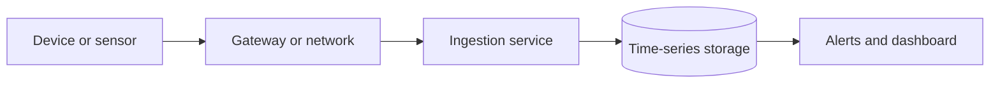

# 23. Specialist Software Domains: Embedded, IoT, GIS, Gaming & Real-Time Systems

Ye chapter un fields ka overview deta hai jinke constraints ordinary business web apps se kaafi alag ho sakte hain.

## 1. Embedded systems and firmware
Embedded system kisi larger device ke andar computing karta hai: vehicle controller, appliance, sensor, medical device, industrial machine. Firmware hardware ke close run karta hai. Constraints include memory, power, timing, hardware interfaces, update safety and long support life. Real-time system mein correctness ka part timing bhi hota hai; hard real-time deadlines miss karna catastrophic ho sakta hai, soft real-time mein quality degrade ho sakti hai.

Key concepts: microcontrollers, interrupts, timers, device drivers, memory-mapped I/O, bootloaders, watchdogs, hardware abstraction, RTOS, cross-compilation and hardware-in-the-loop testing. Updates should be signed, recoverable and resilient to power loss.

## 2. IoT architecture
Sensor/device → gateway/network → ingestion broker → device registry → storage/rules → dashboard/automation. Connectivity choices include Wi-Fi, Ethernet, cellular, Bluetooth Low Energy, Zigbee, Thread and LPWAN technologies; range, bandwidth, battery life, reliability and cost trade off.

Device fleet management includes provisioning, identity, certificates/keys, firmware inventory, telemetry, remote configuration, update rollout and decommissioning. Unique device identity, secure boot, signed firmware and safe update rollback are important. Never assume a device is secure just because it is behind a private network.

## 3. GIS and geospatial software
Geographic Information Systems handle coordinates, spatial features and raster data. Concepts: coordinate reference systems, projections, geometry types (point/line/polygon), spatial indexes, geocoding, routing, tile servers, map layers and spatial joins. Latitude/longitude values without datum/CRS context can produce incorrect maps. Location data can be sensitive; minimize precision and retention where possible.

Mapping products also need accessibility, offline tile strategies, data licensing, attribution, freshness, route safety and clear uncertainty. Geospatial results can be misleading when projections, sampling or missing data are ignored.

## 4. Game development and real-time graphics
Game systems combine simulation, input, rendering, audio, assets, physics, networking and persistence. Frame budget is constrained: at 60 frames per second, a frame has about 16.7 ms total budget. Game loops commonly separate update/simulation from rendering; deterministic simulation is useful for replays and some multiplayer designs.

Concepts: engines, scene graphs, entity-component systems, shaders, GPU/CPU bottlenecks, asset pipelines, collision, animation, frame pacing, latency compensation, anti-cheat and platform certification. Multiplayer architecture depends on authoritative server, peer-to-peer or hybrid trade-offs; trust boundaries must be explicit.

## 5. High-performance and scientific computing
Scientific computing prioritizes numerical correctness, reproducibility, parallelism, data movement and validation. GPU acceleration helps parallel workloads but is not universally faster. Floating-point arithmetic has rounding error; algorithms must consider stability and precision. Benchmark representative data and compare outputs against trusted baselines.

## 6. AR/VR and spatial computing
Systems track pose, render stereoscopic views, handle input and maintain low motion-to-photon latency to reduce discomfort. Coordinate frames, calibration, spatial privacy, accessibility, locomotion and device constraints matter. Sensor data can reveal sensitive behavioral and environmental information.

## 7. Safety-critical and regulated systems
A failure can cause harm, so hazard analysis, traceability, independent verification, configuration control, rigorous change review and documented assurance become central. Applicable standards depend on industry and jurisdiction. Do not infer that passing a generic test suite is sufficient evidence of safety.

## How to approach any specialist field
1. Identify domain constraints and failure consequences.
2. Learn its core standards, data formats and hardware/platform limits.
3. Build a safe sandbox prototype.
4. Define measurable acceptance and safety criteria.
5. Test edge cases and degraded modes.
6. Review licensing, privacy, update and long-term maintenance.

## Visual example (diagram)

**IoT data path** — is simplified flow ko real system ke example ki tarah dekhein.

