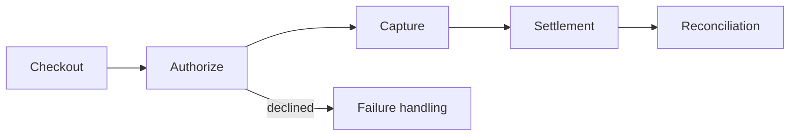

# 24. Specialist Business Domains: FinTech, Health IT, E-commerce & Blockchain

## 1. FinTech and payments
Payment systems must model states precisely: initiated, authorized, captured, settled, refunded, reversed, disputed. A UI success message should not imply settlement unless the underlying payment status confirms it. Webhooks can be delayed, duplicated or arrive out of order; verify signatures, persist event IDs and process idempotently.

Important concepts: payment gateway vs processor, tokenization, reconciliation, ledger entries, fraud detection, chargebacks, currency/rounding, settlement timing, audit trail and separation of duties. Financial balances should be derived from well-defined ledger rules rather than casually edited totals. Regulatory obligations depend on role, country, product and data handled; use qualified compliance/legal review.

## 2. Trading and exchange systems
Market data, order entry, risk checks, matching, trade events, settlement and account balances are distinct domains. Define order states, cancel/replace behavior, precision/tick-size, rate limits, idempotency, sequencing and auditability. A market-data feed may be delayed or incomplete; label freshness and handle reconnect/resynchronization. Risk controls should not rely only on frontend validation.

## 3. Health IT
Health systems can include electronic health records, scheduling, billing, labs, imaging, patient portals and clinical decision support. Interoperability standards and privacy requirements vary by region and use case. Data provenance, patient identity matching, consent, auditability, access controls, retention and safe downtime procedures matter. Incorrect data can have real consequences, so clinical validation and professional oversight are necessary.

## 4. E-commerce
Typical components: catalog, search, inventory, pricing, cart, checkout, payment, fulfillment, returns, promotions, tax and customer support. Inventory and payment can race under concurrent purchases; use reservation/expiry patterns and reconciliation. Search relevance, product data quality, fraud prevention, accessibility, page performance and experimentation affect conversion.

Cache public product pages carefully; never accidentally serve another user's cart, account, address or order details. Tax, consumer protection and payment requirements vary by jurisdiction.

## 5. Blockchain and distributed ledgers
A blockchain is a replicated ledger with consensus rules; it is not automatically private, scalable, cheap or tamper-proof in every practical sense. Public chains can expose transaction metadata. Smart contracts are programs whose bugs may be difficult or impossible to reverse after deployment. Key management and recovery are major risks.

Understand consensus, validators/miners, finality, forks, fees, smart-contract audits, bridges, oracles and governance. A database is often simpler and safer when participants trust a central operator. Choose a distributed ledger only when shared control and verifiable history justify its trade-offs.

## 6. Domain-specific engineering checklist
- Identify who can be harmed by incorrect behavior.
- Define state machines and invariants explicitly.
- Reconcile internal records with external systems.
- Make retries and duplicate events safe.
- Maintain tamper-resistant audit trails without logging secrets.
- Define degraded mode, manual fallback and recovery.
- Review jurisdiction-specific rules with qualified experts.
- Test accessibility, privacy, security and operational readiness.

## Visual example (diagram)

**Payment state flow** — is simplified flow ko real system ke example ki tarah dekhein.

