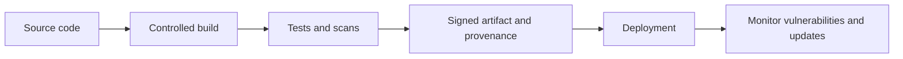

# 25. Standards, Compliance, Open Source & Software Supply-Chain Security

**Project:** Software & IT Services — Deep Research & Study Notes  
**Owner / Content Creator:** Sandeep Barupal  
**Copyright:** © 2026 Sandeep Barupal. All rights reserved, except as stated below.

## 1. Standards vs frameworks vs laws
A standard defines agreed technical or process specifications; a framework organizes controls/practices; a law creates legal obligations within its jurisdiction. Certification, audit and compliance evidence are different activities. Which applies depends on industry, customer contract, geography, company role and data type.

## 2. Secure software supply chain
Modern software depends on packages, build tools, actions, base images, registries and deployment systems. Risk can enter through compromised dependencies, typo-squatting, malicious maintainers, stolen publishing credentials or poisoned build pipelines.

Useful controls: pin and review dependencies, use lockfiles, scan known vulnerabilities, review package provenance, minimize build permissions, protect CI secrets, use trusted registries, generate SBOMs where appropriate, sign artifacts and verify provenance. A scan is only a point-in-time signal; it cannot prove software is safe.

## 3. SBOM and provenance
A Software Bill of Materials lists software components and metadata. It helps answer “what is included?” Build provenance describes how an artifact was produced. Keep component versions and licenses accurate; tie attestations to the actual build artifact. A document alone is not useful if it is not maintained and linked to releases.

## 4. Vulnerability management
Track affected versions, exploitability, exposure, available fixes, business impact and compensating controls. Define severity and remediation deadlines; validate fixes and communicate residual risk. Coordinated disclosure programs should provide a safe reporting channel and clear expectations. Do not test systems without authorization.

## 5. Open-source governance
Before adding a dependency, assess maintenance health, license compatibility, security history, transitive dependencies, update cadence and exit alternatives. Preserve notices and meet license conditions. Establish approved patterns without blocking useful community software unnecessarily.

## 6. Compliance operations
Map control to owner, system scope, evidence source, frequency, exception and remediation. Evidence should be current, access-controlled and traceable. Avoid collecting excessive personal data in audit logs. Policies that are not implemented or tested do not create effective control.

## 7. Change and release evidence
For each release, retain appropriate version, build identifier, test results, approvals, artifact provenance, migration notes and rollback procedure. Access to production and signing credentials should be limited and audited. Emergency changes still need retrospective review.

## 8. Practical exercise
For a small web app:
1. Generate a dependency inventory.
2. Review license and known-vulnerability reports.
3. Protect CI credentials and reduce permissions.
4. Record build version and artifact checksum.
5. Create a vulnerability remediation process.
6. Write a release evidence checklist.
7. Document which legal/compliance questions require expert review.

## Questions
1. SBOM and vulnerability scan mein difference?
2. A clean scan prove karta hai ki app secure hai?
3. Why pin dependencies and protect CI credentials?
4. Standard, framework and law ka difference?

## Visual example (diagram)

**Software supply chain** — is simplified flow ko real system ke example ki tarah dekhein.

## Practical deep dive: open source aur software supply chain

### Dependency ka matlab
Aapka project external libraries, packages, build tools, container images aur actions par depend kar sakta hai. Har dependency functionality ke saath maintenance, vulnerability aur licensing risk bhi la sakti hai.

### Review checklist
1. Project active/maintained hai? Releases aur issue response check karo.
2. License kya allow/require karti hai? Obligations exact license text aur usage se depend karte hain.
3. Known vulnerabilities hain? Advisories aur compatible fixed versions check karo.
4. Dependency kahan se aayi aur exact version/pin kya hai?
5. Transitive dependencies aur build scripts kya karte hain?
6. Update, rollback aur incident response plan kya hai?
7. Required notices/attribution package ke saath preserve kiye gaye hain?

### SBOM aur provenance
- **SBOM:** software mein included components ki inventory.
- **Provenance:** artifact ka source/build process evidence.
Ye supply-chain visibility improve karte hain, lekin khud se vulnerability-free ya trustworthy build guarantee nahi karte.

### Secure dependency workflow
Use trusted registries, lockfiles/version pinning where appropriate, automated alerts, review updates, test changes, protect CI credentials aur release artifacts ko traceable rakho. Unknown install scripts ko blindly execute mat karo.

### Practice lab
Ek small project ke dependencies list karo. Har dependency ke liye purpose, version, license, maintenance signal aur vulnerability-check result record karo. High-risk dependency ke replacement/upgrade plan ka draft banao.

### Further learning
- [Open Source Initiative licenses](https://opensource.org/licenses)
- [GitHub Dependabot documentation](https://docs.github.com/en/code-security/dependabot)
- [NIST Secure Software Development Framework](https://csrc.nist.gov/Projects/ssdf)

## Quick answer guide
1. A dependency can introduce licensing, maintenance, vulnerability and supply-chain risk.
2. An SBOM inventories software components but does not prove they are all safe.
3. License obligations depend on the exact license and how the component is used/distributed; review the license text.
4. Lockfiles and version pins improve reproducibility but do not replace security review and updates.

## Review status
- Content milestone: practical beginner expansion.
- Verification status: not yet independently deep-reviewed.
- Last content expansion: 2026-10-30.
- Next review: verify current GitHub/NIST/license resources and add a sample dependency inventory.

## Worked dependency review record

For each important dependency, record:
- Name and exact version
- Why the project needs it
- Direct or transitive dependency
- License and applicable obligations
- Maintenance/release signals
- Known vulnerability/advisory status and checked date
- Source registry and lockfile evidence
- Update owner and planned review date
- Alternative or mitigation if the project becomes unmaintained

A “no known vulnerability” result means none was found in the checked source at that time; it does not prove the dependency is safe. Keep the check date and tool/database scope visible.

## Lab review checklist
A strong dependency record identifies exact component/version, purpose, license, maintenance signal, advisory check date, provenance and owner. A clean scan is not a guarantee of safety; document limitations and a plan for updates or replacement. Preserve required notices and attribution.
