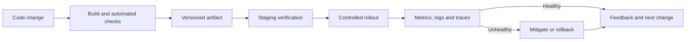

# Chapter 29 — High-Impact Technical Topics: Easy Explanations & Practical Notes

Ye chapter un topics ko beginner-friendly tareeke se connect karta hai jo ek broad IT syllabus mein aksar sirf naam ke taur par reh jaate hain. Har topic ko actual project ki need ke hisaab se deeper lab ki zaroorat ho sakti hai.

## 1. Operating system, process and thread

**Operating system (OS)** hardware resources ko manage karta hai aur apps ko services deta hai. **Process** ek running program ka isolated execution environment hota hai. **Thread** process ke andar execution path hota hai; threads resources share kar sakte hain, isliye synchronization matter karti hai.

Example: Browser ek se zyada processes/threads use kar sakta hai taaki tabs, rendering aur background work ko organize kiya ja sake. Exact architecture browser aur version par depend karta hai.

Common problems: CPU saturation, memory exhaustion, deadlocks, race conditions and file/permission errors.

## 2. Concurrency vs parallelism

- **Concurrency:** multiple tasks ki progress overlapping hoti hai; system tasks ke beech switch kar sakta hai.
- **Parallelism:** multiple tasks literally same time par different execution resources par chal sakte hain.
- **Race condition:** result execution timing/order par depend kar jata hai.
- **Deadlock:** tasks ek doosre ke resources ka wait karte reh jaate hain.
- **Async I/O:** waiting for network/disk ke dauran doosra work progress kar sakta hai.

Browser JavaScript mein event loop callbacks/tasks schedule karta hai; long-running main-thread work UI ko block kar sakta hai. Web Workers suitable work ko separate worker context mein run kar sakte hain, lekin DOM ko directly manipulate nahi karte.

**Practice:** page par heavy loop run karne se UI responsiveness par kya effect hoga? DevTools Performance panel mein record karke observe karo. Phir work ko chunks mein divide karne ya suitable worker use karne ka plan banao.

## 3. Git and code collaboration

- **Repository:** tracked project history.
- **Commit:** changes ka recorded snapshot.
- **Branch:** independent line of development.
- **Merge/rebase:** changes ko combine/replay karne ke different approaches.
- **Pull request:** review aur discussion ke through proposed changes.
- **Conflict:** Git automatic decision nahi kar sakta, isliye developer ko reconcile karna hota hai.

Safe workflow: small focused branch → meaningful commits → tests → review → merge → verify main branch. Secrets, private data ya generated build artifacts accidentally commit na karo. Public repository mein published secret ko sirf commit delete karke safe nahi maana ja sakta; credential rotate/revoke karna padta hai.

**Practice:** ek harmless text file change karo, branch banao, commit karo, pull request flow rehearse karo aur conflict resolution ka toy example try karo.

## 4. CDN, cache, load balancer and autoscaling

- **CDN:** user ke paas ke edge locations se cacheable content serve karke latency/origin load reduce kar sakta hai.
- **Cache:** recently/frequently used data ko faster access ke liye temporarily store karta hai.
- **Load balancer:** incoming requests ko available backends par distribute karta hai.
- **Autoscaling:** demand/metrics ke basis par capacity increase/decrease karta hai.

Ye interchangeable nahi hain. CDN static assets ke liye useful ho sakta hai, lekin personalized/private response ko galat cache karna data leak kar sakta hai. Load balancer unhealthy instances ko avoid kar sakta hai only if health checks and configuration correct hon. Autoscaling ko start hone mein time lag sakta hai aur database bottleneck solve nahi hota automatically.

**Practice:** ek e-commerce page ke liye identify karo kaunsa content public-cacheable hai aur kaunsa user-specific. Cache key, TTL, invalidation aur bypass conditions define karo.

## 5. Infrastructure as Code (IaC) and configuration

IaC infrastructure configuration ko version-controlled code ke through define karta hai. Benefits: repeatability, reviewable changes and drift detection. Risks: over-permissioned credentials, destructive changes and accidental public exposure.

Safe workflow:
1. Change diff/plan inspect karo.
2. Use least-privilege credentials.
3. Validate and test in non-production first.
4. Protect secrets and state files.
5. Approval/change-control follow karo where required.
6. Apply and verify actual service health.
7. Recovery plan and audit trail maintain karo.

## 6. REST, GraphQL, RPC, webhooks and queues

- **REST-style API:** resources and HTTP semantics ke around interface.
- **GraphQL:** client selected fields request kar sakta hai; server-side query limits/authorization still matter.
- **RPC:** operation/function-like remote call.
- **Webhook:** event ke baad sender receiver ko HTTP request bhejta hai; delivery retries/duplicates possible.
- **Message queue:** producer aur consumer ko decouple karta hai; message delay, redelivery and ordering rules design karne hote hain.

API type choose karte waqt team familiarity, caching, tooling, data needs, authorization and operational complexity compare karo. Kisi pattern ka naam use karna robust design ka proof nahi.

**Practice:** “Order shipped” event ko webhook se notify karne ka contract likho: event ID, timestamp, payload version, signature verification, retries, duplicate handling and failure monitoring.

## 7. Web performance and browser rendering

Page performance sirf total load time nahi. User-visible responsiveness, layout stability, network transfer, JavaScript execution and rendering all matter. Large images, render-blocking resources, excessive JavaScript and layout shifts user experience ko hurt kar sakte hain.

Practical workflow:
1. Realistic device/network condition choose karo.
2. Baseline measurement record karo.
3. Largest resources and long tasks identify karo.
4. Image dimensions/formats, caching and bundle size review karo.
5. Change one bottleneck at a time.
6. Re-measure and compare; avoid claims based on one run alone.

## 8. Containers and orchestration

Container app plus required runtime dependencies ko package kar sakta hai, but host kernel/resources share karta hai. Image ko minimal and patched rakho, non-root where feasible, secrets image ke andar bake na karo, and resource limits/logging define karo.

Orchestration platforms scheduling, service discovery, scaling and health management support kar sakte hain, lekin operational complexity add karte hain. Small workloads ke liye managed platform simpler ho sakta hai.

## 9. Data warehouse, lake, ETL and ELT

- **ETL:** source se extract, transform, then destination mein load.
- **ELT:** extract/load first, transform in destination platform.
- **Warehouse:** structured analytics/reporting ke liye curated data.
- **Data lake:** diverse raw/processed data store kar sakta hai; governance ke bina “data swamp” ban sakta hai.
- **Lineage:** data ka source aur transformation path.
- **Data contract:** producer/consumer ke beech schema/quality expectations.

**Practice:** daily sales report ke pipeline mein duplicate orders, timezone boundaries, late-arriving events and schema changes handle karne ka plan likho.

## 10. AI embeddings, RAG and model operations

- **Embedding:** content ka numeric representation jo similarity search mein help kar sakta hai.
- **Vector search:** similar representations retrieve karne ka approach.
- **RAG:** retrieved source material ko model response banate waqt context ke roop mein use karna.
- **Evaluation:** retrieval relevance, answer correctness, safety, latency and cost test karna.
- **Model/data drift:** input patterns ya real-world conditions change hone se performance degrade ho sakti hai.

RAG hallucinations ko automatically eliminate nahi karta. Retrieved content outdated, irrelevant ya maliciously crafted ho sakta hai. Access controls retrieval ke waqt apply karo, sensitive data leakage test karo, citations/grounding verify karo and human review where risk requires.

## 11. Cost and capacity basics

A rough capacity estimate explicit assumptions ke saath banao:
- Daily requests / 86,400 ≈ average requests per second.
- Estimate peak factor separately.
- Storage = records × average size × retention, plus indexes, replicas and backups.
- Cost model mein compute, storage, network, managed services, logs, support and staff time include karo.

Rough estimates planning tools hain, production sizing ka substitute nahi. Real measurements se validate karo.

## Review status
- Content milestone: high-impact supplemental technical explanations and mini-practices.
- Verification status: conceptual notes; runnable labs and primary-source review still pending.
- Last content expansion: 2026-10-30.
- Next review: map each section to relevant core chapters, verify official references, and add reproducible labs with expected outputs.

## Quick self-check answer guide

1. **Concurrency vs parallelism:** concurrency is overlapping progress among tasks; parallelism means tasks execute at the same time on separate execution resources.
2. **Why can frontend validation be bypassed?** Browser code and requests are under user control; the server must enforce permissions and business rules.
3. **Why is cache invalidation important?** Cached content may be stale or, if the cache key/policy is wrong, expose user-specific data.
4. **Why can autoscaling fail to solve latency?** The bottleneck may be a database, a third-party dependency, a quota, a lock or a slow startup time.
5. **Why must webhooks handle duplicates?** Sender retries may deliver an event more than once; receiver should use event identifiers/idempotent processing.
6. **Does RAG guarantee correct AI output?** No. Retrieval may be incomplete/wrong and the model can still produce unsupported claims.
7. **What does IaC not automatically guarantee?** Safe configuration. Plans, permissions, reviews, state protection and verification remain necessary.
8. **Why measure performance before optimizing?** A measured baseline helps identify the actual bottleneck and verify whether a change improved it.
9. **Does an SBOM prove all dependencies are safe?** No. It is an inventory that supports further security and licensing review.
10. **What makes a capacity estimate useful?** Explicit assumptions, ranges, peak demand, overheads and later validation against real measurements.

## Practice outcomes to submit
For each mini-practice above, save one artifact in your own study notes: a browser performance observation, a Git branch/PR rehearsal, a cache policy table, an IaC change checklist, an API/webhook contract, a data pipeline diagram or an AI/RAG evaluation plan. Record the test environment and what remains unverified.

## Visual: a typical delivery and operations loop

The diagram is a generic teaching flow, not a prescription for every organization. Required approvals, security checks and rollout strategy depend on the system's risk.

## Further learning — official documentation
- [MDN — Using Web Workers](https://developer.mozilla.org/en-US/docs/Web/API/Web_Workers_API/Using_web_workers)
- [MDN — HTTP Caching](https://developer.mozilla.org/en-US/docs/Web/HTTP/Guides/Caching)
- [NIST — Secure Software Development Framework](https://csrc.nist.gov/projects/ssdf)
- [GitHub Skills](https://skills.github.com/)
- [Google Cloud — Load Balancing documentation](https://docs.cloud.google.com/load-balancing/docs/)

Read version-specific documentation before applying commands or configuration in a real environment.
