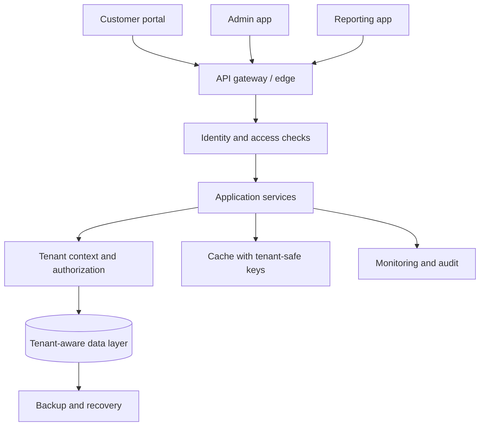

# Chapter 30 — Advanced Web Architecture: Easy-Language Deep Dive

**Project:** Software & IT Services — Deep Research & Study Notes  
**Owner / Content Creator:** Sandeep Barupal  
**Copyright:** © 2026 Sandeep Barupal. All rights reserved, except as stated below.

Is chapter mein advanced web-platform topics ko simple language mein samjhaya gaya hai. Architecture choose karte waqt complexity ko actual need ke saath balance karna zaroori hai.

## 1. Multi-app system

Multi-app system mein ek organization ke multiple applications hote hain—jaise customer portal, admin portal, reporting app aur mobile app. Ye alag UI rakh sakte hain, lekin identity, APIs, data rules, design system, monitoring aur release governance share kar sakte hain.

**Design questions**
- Apps ka common login/SSO kaise hoga?
- Shared APIs aur common components ka owner kaun hai?
- Har app ke permissions aur data boundaries kya hain?
- App A fail ho to kya App B bhi unavailable ho jayegi?
- Version compatibility aur deprecation kaise handle honge?

**Risk:** shared service central dependency ban sakti hai. Contracts, ownership, health monitoring and fallback behaviour define karo.

## 2. Multi-tenant architecture

Multi-tenant application ek shared product/platform ke through multiple customers/organizations (tenants) serve karti hai.

### Common data-isolation models
- **Shared database, shared tables:** tenant ID rows ko identify karta hai; query-level isolation aur access controls critical.
- **Shared database, separate schema:** logical separation stronger ho sakti hai, but operations/migrations complex ho sakte hain.
- **Separate database per tenant:** stronger operational/data separation options, but cost and management overhead increase.
- **Hybrid:** different tenant tiers ko different isolation models.

Koi model automatically secure nahi. Server-side authorization, tenant context validation, background job isolation, cache key design, file storage paths, analytics and support tooling sab tenant-aware hone chahiye.

### Tenant isolation test ideas
1. Tenant A ke user se Tenant B ka record ID request karo; access deny hona chahiye.
2. Cache response Tenant A se Tenant B ko leak na ho.
3. Background job correct tenant context use kare.
4. Export/report only authorized tenant data include kare.
5. Admin/support access audited aur limited ho.
6. Tenant offboarding ke baad retention/deletion rules follow hon.

## 3. Micro-frontend architecture

Micro-frontends large frontend ko independently owned/deployed parts mein split karne ka approach hai. Different teams checkout, account, catalogue ya admin module par kaam kar sakti hain.

### Possible benefits
- Team ownership and release independence.
- Large codebase ko domain boundaries ke hisaab se organize karna.
- Different modules ko gradually migrate karna.

### Trade-offs
- Duplicate libraries and larger downloads.
- Inconsistent UI/accessibility.
- Routing, shared authentication, error boundaries and design system complexity.
- Runtime integration failures and version mismatch.
- Testing and observability across modules harder.

Small/medium app ke liye modular frontend monolith often simpler hota hai. Micro-frontends tab consider karo jab team/domain/release boundaries real problem solve karte hon.

## 4. Safe release strategy

Safe release ka goal change ko controlled exposure ke saath ship karna, impact detect karna aur issue aaye to recover karna hai.

### Release checklist
1. Code review and automated checks pass.
2. Relevant security/dependency scans reviewed.
3. Test/staging verification complete.
4. Database/API changes backward-compatible where feasible.
5. Monitoring dashboards and alert ownership ready.
6. Rollout percentage/tenant/user group define.
7. Success metrics and abort thresholds define.
8. Rollback or mitigation plan tested as far as practical.
9. Support team and affected stakeholders informed.
10. After rollout, health and user outcomes verify.

### Strategies
- **Canary:** small traffic/user group first.
- **Blue-green:** switch between old and new environments.
- **Rolling:** update instances in batches.
- **Feature flag:** control feature availability independently of deployment.

Rollback may not undo data migrations or external side effects. Use expand-and-contract schema changes and explicit recovery plans.

## 5. CDN and caching strategy

CDN edge locations cache eligible content nearer users, reducing latency and origin load. Cache policy must distinguish public static content from personalized/private data.

### Cache design questions
- Is the response public or user-specific?
- Which request attributes change the response?
- What is the TTL and invalidation strategy?
- What happens after a content update?
- Can stale content cause harm?
- Are authorization checks bypassed by a shared cache?

Never assume a response is safe to cache just because it is a GET request. Test cache keys, cookies, authorization headers and privacy boundaries.

## 6. Load balancing and health checks

A load balancer distributes incoming requests across backend targets. Algorithms may include round-robin, least-connections or other policies depending on product and workload.

Health checks help determine whether a target should receive traffic. A shallow “process is alive” check may pass while a critical dependency is broken; overly deep checks can cause cascading removal of all targets. Define liveness/readiness separately where the platform supports it.

Load balancing does not automatically solve:
- Database bottlenecks
- Slow third-party APIs
- Shared session/state problems
- Bad application code
- Capacity shortages in every backend
- Retry storms

## 7. Browser concurrency and rendering

Browser pages handle input, JavaScript tasks, rendering and network activity. Long synchronous JavaScript on the main thread can delay clicks, animations and painting.

### Practical rules
- Keep main-thread tasks short.
- Use async I/O for network waiting.
- Break large work into chunks or use Web Workers when appropriate.
- Avoid unnecessary layout reads/writes that cause repeated layout work.
- Cancel/ignore stale requests when the user changes search input quickly.
- Measure with browser developer tools before optimizing.

**Mini lab:** create a search field that sends delayed mock results. Type quickly and observe whether older results can overwrite newer ones. Add a request counter or cancellation strategy, then verify the displayed results correspond to the latest query.

## 8. Multi-app and multi-tenant release matrix

Before rollout, test combinations that commonly fail:
- Old frontend + new API
- New frontend + old API during staged rollout
- Tenant with large data volume
- Tenant with restricted features/plan
- Admin user vs regular user
- Mobile viewport and keyboard navigation
- Cache hit vs cache miss
- Dependency outage and recovery

## Practice assignment

Design a fictional B2B platform with customer portal, admin app and reporting app for 50 organizations.

Submit:
1. Context diagram showing apps, APIs and identity.
2. Tenant isolation model with rationale.
3. A decision record on modular frontend vs micro-frontends.
4. CDN/cache rules for public and private pages.
5. Load-balancer health-check policy.
6. Canary rollout plan with success and abort thresholds.
7. Browser responsiveness test.
8. Threat model and tenant-isolation test cases.
9. Rollback/mitigation plan including data migration risks.

## Quick answer guide
1. **Does multi-tenancy mean one database for all tenants?** No. It describes serving multiple tenants; isolation models vary.
2. **Are micro-frontends always better for large apps?** No. They add integration and operational complexity.
3. **Can rollback reverse every release effect?** No. Data changes and external side effects may need forward fixes or compensating actions.
4. **Does CDN make all pages faster and safe to cache?** No. Cacheability depends on content, freshness, privacy and request variation.
5. **Does load balancing solve every performance issue?** No. It distributes requests but cannot automatically fix downstream bottlenecks.
6. **Why test old and new versions together?** Rolling/staged releases may have both versions running at once.

## Review status
- Content milestone: focused advanced architecture learning chapter.
- Verification status: conceptual guidance; exact platform configuration must be verified against the chosen provider/product.
- Last content expansion: 2026-10-30.
- Next review: add provider-specific examples, runnable browser lab, architecture diagrams and current primary-source checks.


## Visual: simplified multi-tenant multi-app platform



This is a simplified logical diagram. A production design must define where tenant identity is derived and validated, how data isolation is enforced, and how caches, background jobs, exports, support access and backups preserve tenant boundaries.


## Further learning — official documentation
- [MDN — Using Web Workers](https://developer.mozilla.org/en-US/docs/Web/API/Web_Workers_API/Using_web_workers)
- [MDN — HTTP Caching](https://developer.mozilla.org/en-US/docs/Web/HTTP/Guides/Caching)
- [Google Cloud — Load Balancing documentation](https://docs.cloud.google.com/load-balancing/docs/)
- [Microsoft Learn — Resource isolation with multiple tenants](https://learn.microsoft.com/en-us/entra/architecture/secure-multiple-tenants)
- [AWS Well-Architected — Safe deployment strategies](https://docs.aws.amazon.com/wellarchitected/latest/operational-excellence-pillar/ops_mit_deploy_risks_deploy_mgmt_sys.html)

These references cover particular platforms or concepts; their implementation details are not universal across vendors.


## Runnable browser-concurrency lab: prevent stale search results

Save as an HTML file and open in a browser. The mock search intentionally returns at different speeds. A request counter prevents an older response from overwriting the latest query.

```html
<label for="q">Search demo</label>
<input id="q" type="search" autocomplete="off">
<p id="status" aria-live="polite"></p>
<ul id="results"></ul>
<script>
  const input = document.querySelector("#q");
  const status = document.querySelector("#status");
  const results = document.querySelector("#results");
  let latestRequestId = 0;

  function mockSearch(query) {
    const delay = 150 + Math.random() * 900;
    return new Promise(resolve => {
      setTimeout(() => {
        resolve(query ? [query + " result 1", query + " result 2"] : []);
      }, delay);
    });
  }

  input.addEventListener("input", async () => {
    const query = input.value.trim();
    const requestId = ++latestRequestId;
    status.textContent = "Searching...";
    try {
      const items = await mockSearch(query);
      if (requestId !== latestRequestId) return; // ignore stale result
      results.replaceChildren();
      for (const value of items) {
        const li = document.createElement("li");
        li.textContent = value;
        results.append(li);
      }
      status.textContent = items.length ? items.length + " results" : "No results";
    } catch {
      if (requestId === latestRequestId) status.textContent = "Search failed. Try again.";
    }
  });
</script>
```

### Expected result
Type quickly, for example “c”, “ca”, then “cat”. Responses may finish out of order, but only the latest query's results should appear. Random timing makes the race easier to observe; remove randomness for deterministic automated tests.

### Extension
Replace the mock function with a real fetch call. Consider AbortController to cancel obsolete requests, handle HTTP error responses, and keep server-side rate limits in place. Client-side cancellation does not guarantee the server never started processing the request.
